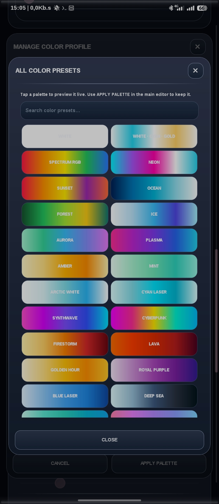
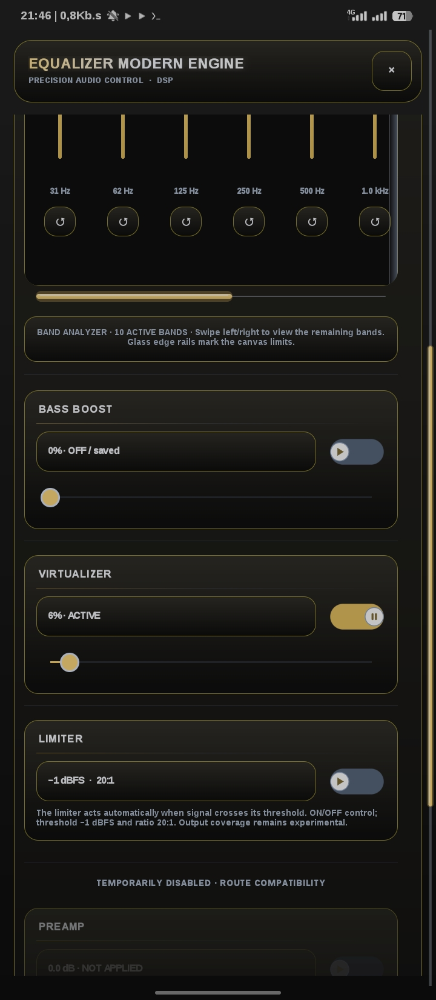
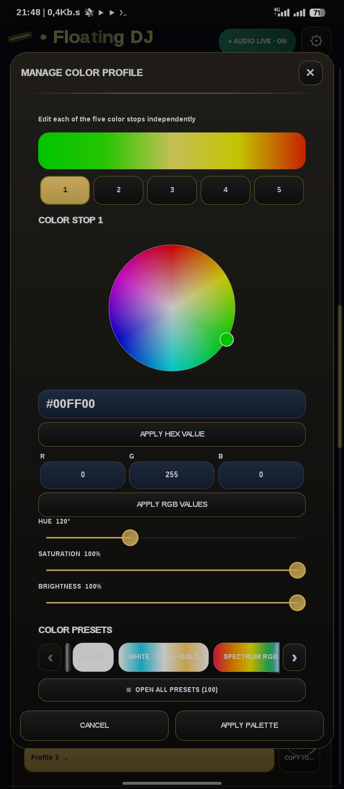

  <h1>Floating DJ Visualizer</h1>
  <h3>Android Floating Audio Visualizer and Experimental Equalizer</h3>
  
<strong>Developed by Rifki</strong>

  
  
  
  

<strong>Visualize your sound. Customize every layer.</strong>

<strong>EN:</strong> A customizable floating audio visualizer with layered profiles, reusable scenes, Theme Studio, and an experimental device-dependent Equalizer Engine.

<strong>ID:</strong> Aplikasi floating audio visualizer yang dapat dikustomisasi dengan profile berlapis, scene yang dapat digunakan kembali, Theme Studio, dan Equalizer Engine eksperimental yang bergantung pada perangkat.

<a href="#app-preview">Preview</a> | <a href="#features">Features</a> | <a href="#audio-processing-notes">Audio Notes</a> | <a href="#compatibility">Compatibility</a> | <a href="#changelog">Changelog</a> | <a href="#contact">Contact</a>

---

## Table of Contents

- [App Preview](#app-preview)
- [About the Project](#about-the-project)
- [Key Features](#features)
- [Test Presets](#test-presets)
- [Technology Stack](#technology-stack)
- [Compatibility](#compatibility)
- [Audio Processing Notes](#audio-processing-notes)
- [Changelog: V3.0.10 to V3.0.18](#changelog)
- [Contact](#contact)

---

## App Preview

<table>
  <tr>
    <td width="50%"></td>
    <td width="50%"></td>
  </tr>
  <tr>
    <td width="50%"></td>
    <td width="50%"></td>
  </tr>
  <tr>
    <td width="50%"></td>
    <td width="50%"></td>
  </tr>
</table>

EN: More screenshots are available in the [`dokumentasi/`](dokumentasi/) folder.

ID: Kumpulan tangkapan layar lainnya tersedia di folder [`dokumentasi/`](dokumentasi/).

---

## About the Project

**EN**

Floating DJ Visualizer is an Android application developed by **Rifki**. It started as a floating audio visualizer and has grown into a visual workspace for real-time audio-reactive displays. The app includes independent floating profiles, layer controls, reusable scenes, detailed appearance settings, and an additional experimental Equalizer Engine.

The project is developed directly on an Android device using the open-source [CodeAssist IDE](https://github.com/tyron12233/CodeAssist).

**ID**

Floating DJ Visualizer adalah aplikasi Android yang dikembangkan oleh **Rifki**. Proyek ini bermula sebagai floating audio visualizer dan berkembang menjadi workspace visual yang merespons audio secara real-time. Aplikasi ini menyediakan floating profile independen, kontrol layer, scene yang dapat digunakan kembali, pengaturan tampilan mendalam, serta Equalizer Engine tambahan yang masih eksperimental.

Proyek ini dikembangkan langsung melalui perangkat Android menggunakan [CodeAssist IDE](https://github.com/tyron12233/CodeAssist) yang bersifat open-source.

> **Project status / Status proyek:** V3.0.18 is the current development line. The Equalizer Engine remains experimental and device-dependent. / V3.0.18 adalah lini pengembangan saat ini. Equalizer Engine masih eksperimental dan bergantung pada perangkat.

---

## Key Features

### 1. Audio Visualization

- **Floating Overlay**  
  EN: Displays the visualizer above other apps after the user grants Android overlay permission.  
  ID: Menampilkan visualizer di atas aplikasi lain setelah pengguna memberikan izin overlay Android.

- **Visualizer Modes**  
  EN: Supports Single and Horizontal / DJ visualization layouts.  
  ID: Mendukung layout visualisasi Single dan Horizontal / DJ.

- **Bar Controls**  
  EN: Configure bar count, width, height, thickness, gap, scale, opacity, glow, and corner shape where supported by the selected mode.  
  ID: Mengatur jumlah bar, lebar, tinggi, ketebalan, jarak, skala, opacity, glow, dan bentuk sudut sesuai mode yang dipilih.

- **Frequency Display**  
  EN: Shows frequency ranges and activity levels for the selected visualization mode.  
  ID: Menampilkan rentang frekuensi dan level aktivitas sesuai mode visualisasi yang dipilih.

- **Appearance Styles**  
  EN: Includes Clean, Glossy, Neon, and Frosted styles with editable color profiles.  
  ID: Menyediakan gaya Clean, Glossy, Neon, dan Frosted dengan color profile yang dapat diedit.

- **Position Studio**  
  EN: Configure the position, movement, and rotation of each floating layer.  
  ID: Mengatur posisi, pergerakan, dan rotasi setiap floating layer.

### 2. Visual Studio and Workflow

- **Theme Studio**  
  EN: Provides Glossy, Custom, System, Dark, and Light interface themes.  
  ID: Menyediakan tema antarmuka Glossy, Custom, System, Dark, dan Light.

- **Floating Profiles and Layers**  
  EN: Maintain multiple independent visualizer layers and reorder them.  
  ID: Mengelola beberapa layer visualizer secara independen dan mengubah urutannya.

- **Per-Slider Linking**  
  EN: Link one supported parameter from a source layer to multiple compatible target layers. Compatibility is checked against each layer's visualization mode.  
  ID: Menghubungkan satu parameter dari layer sumber ke beberapa layer tujuan yang kompatibel. Kesesuaian diperiksa berdasarkan mode visualisasi setiap layer.

- **Copy To**  
  EN: Copy supported profile or appearance settings to another layer.  
  ID: Menyalin pengaturan profile atau tampilan yang didukung ke layer lain.

- **Floating Scene Manager**  
  EN: Save, load, update, rename, delete, import, and export complete floating scenes.  
  ID: Menyimpan, memuat, memperbarui, mengganti nama, menghapus, mengimpor, dan mengekspor scene floating secara lengkap.

- **Reversible Numeric Preview**  
  EN: Preview slider and numeric changes in real time, then commit or cancel them.  
  ID: Melihat preview perubahan slider dan angka secara real-time, kemudian menyimpan atau membatalkannya.

- **General Import and Export**  
  EN: Back up supported settings, profiles, scenes, and EQ data with validation and an import review. Runtime permissions and active engines are not transferred or automatically started.  
  ID: Mencadangkan pengaturan, profile, scene, dan data EQ yang didukung dengan validasi serta ringkasan impor. Izin runtime dan engine aktif tidak dipindahkan atau dijalankan otomatis.

- **Notification Controls**  
  EN: Provides theme-aware notification controls for supported visualizer and EQ actions.  
  ID: Menyediakan kontrol notifikasi yang mengikuti tema untuk fungsi visualizer dan EQ yang didukung.

### 3. Experimental Equalizer Engine

- **Adaptive EQ Bands**  
  EN: Provides band controls according to the active backend's detected layout, including supported 5-band or 10-band configurations.  
  ID: Menyediakan kontrol band sesuai susunan yang terdeteksi pada backend aktif, termasuk konfigurasi 5-band atau 10-band yang didukung.

- **Band Analyzer and Presets**  
  EN: Reports the detected band layout and filters built-in presets to matching band counts. User presets are managed separately.  
  ID: Menampilkan susunan band yang terdeteksi dan menyaring preset bawaan berdasarkan jumlah band yang sesuai. Preset pengguna dikelola secara terpisah.

- **Band Editing**  
  EN: Includes vertical faders, direct dB value input, and individual band reset.  
  ID: Menyediakan fader vertikal, input nilai dB langsung, dan reset untuk setiap band.

- **Additional Audio Effects**  
  EN: Bass Boost, Virtualizer, and Limiter controls are available where supported by the device and active backend.  
  ID: Kontrol Bass Boost, Virtualizer, dan Limiter tersedia sesuai dukungan perangkat dan backend aktif.

- **EQ Preset Import and Export**  
  EN: Import and export supported EQ preset files.  
  ID: Mengimpor dan mengekspor file preset EQ yang didukung.

---

## Test Presets

EN: Example configurations from development and testing may be available in [`Test - Preset/`](Test%20-%20Preset/). Use files compatible with your app version and review their contents before applying them.

ID: Contoh konfigurasi dari proses pengembangan dan pengujian dapat tersedia di folder [`Test - Preset/`](Test%20-%20Preset/). Gunakan file yang kompatibel dengan versi aplikasi dan periksa isinya sebelum diterapkan.

---

## Technology Stack

| Component | Technology |
|---|---|
| Platform | Android |
| Main language | Kotlin |
| Development IDE | [CodeAssist](https://github.com/tyron12233/CodeAssist) |
| UI framework | Android Views |
| Audio visualization | Android `Visualizer` API and optional MediaProjection PCM analysis |
| Equalizer | Android audio effects and `DynamicsProcessing` where supported |
| Build tools | Gradle and Android Build Tools |

---

## Compatibility

| Item | Configuration |
|---|---|
| Minimum Android | Android 8.0 (API 26) |
| Target SDK | API 36 |
| Device | Android phones and compatible devices |
| Floating Overlay | Requires the user's Android "Display over other apps" permission |
| Audio effects | Availability and control vary by device, ROM, player, and active audio route |

---

## Audio Processing Notes

**EN**

The Equalizer Engine is experimental and device-dependent. The current Android output-mix route is not a universal per-player or system-wide mixer. Effect availability, band count, and control behavior may vary by Android version, manufacturer implementation, and active audio route. Detecting an effect does not guarantee that every application or audio route is processed. Some effects require a compatible player-owned audio session.

Preamp control is restricted on the current output-mix route for output safety.

**ID**

Equalizer Engine masih eksperimental dan bergantung pada perangkat. Jalur output-mix Android saat ini bukan mixer universal per-player atau mixer untuk seluruh sistem. Ketersediaan efek, jumlah band, dan perilaku kontrol dapat berbeda menurut versi Android, implementasi produsen, serta jalur audio aktif. Efek yang terdeteksi tidak menjamin seluruh aplikasi atau jalur audio ikut diproses. Beberapa efek memerlukan audio session milik player yang kompatibel.

Kontrol Preamp dibatasi pada jalur output-mix saat ini demi keamanan level output.

---

## Changelog: V3.0.10 to V3.0.18

The following is a short milestone summary. For detailed implementation notes, see [`CHANGELOG.md`](CHANGELOG.md) and the research files in [`docs/`](docs/).

Berikut ringkasan milestone. Untuk catatan implementasi yang lebih terperinci, lihat [`CHANGELOG.md`](CHANGELOG.md) dan dokumen riset di folder [`docs/`](docs/).

### V3.0.18

- **EN:** Expanded the 5-band and 10-band EQ preset library with capability-based filtering and a Band Analyzer. Refined Display geometry, scroll gutters, theme-aware toasts, dialog/list motion, and Equalizer first-open scroll rail behavior.
- **ID:** Memperluas pustaka preset EQ 5-band dan 10-band dengan penyaringan berdasarkan kemampuan backend serta Band Analyzer. Merapikan geometri Display, gutter scrolling, toast bertema, animasi dialog/daftar, dan indikator scroll Equalizer saat pertama dibuka.

### V3.0.17

- **EN:** Improved general backup/import validation and runtime-permission review. Refined scene status, layer-position controls, and mode-safe parameter linking.
- **ID:** Memperkuat validasi backup/impor umum dan pemeriksaan izin runtime. Merapikan status scene, kontrol posisi layer, dan Linked parameter yang sesuai mode.

### V3.0.16

- **EN:** Introduced multi-layer per-slider linking with mode-aware target selection. Added global FFT/Hop explanations and synchronized Start/Stop notification controls with Theme Studio contrast.
- **ID:** Memperkenalkan Linked multi-layer per slider dengan pemilihan target sesuai mode. Menambahkan penjelasan FFT/Hop global serta sinkronisasi kontrol Start/Stop notifikasi dengan kontras Theme Studio.

### V3.0.15

- **EN:** Added reversible live numeric previews, corrected Theme Studio repaint behavior, refined numeric dialogs, and added Scene Save To.
- **ID:** Menambahkan preview angka real-time yang dapat dibatalkan, memperbaiki repaint Theme Studio, merapikan dialog numerik, dan menambahkan Scene Save To.

### V3.0.14

- **EN:** Corrected FFT decoding and responsiveness, refined frequency-range selection and diagnostics, improved Theme Studio color handling, and strengthened notification cold-start restoration.
- **ID:** Memperbaiki decoding FFT dan responsivitas, merapikan pemilihan rentang frekuensi dan diagnostik, meningkatkan pengelolaan warna Theme Studio, serta memperkuat pemulihan notifikasi saat cold-start.

### V3.0.13

- **EN:** Added visible Play/Pause glyphs to theme-aware switches and refined the EQ preset dropdown animation.
- **ID:** Menambahkan ikon Play/Pause yang terlihat pada switch bertema dan merapikan animasi dropdown preset EQ.

### V3.0.12

- **EN:** Reorganized EQ effect groups, clarified restricted Preamp/Reverb behavior, and refined theme-aware controls and screen motion.
- **ID:** Menata ulang kelompok efek EQ, memperjelas pembatasan Preamp/Reverb, serta merapikan kontrol bertema dan animasi layar.

### V3.0.11

- **EN:** Refined EQ effect controls, added Floating Profile drag auto-scroll and glass scroll feedback, and improved Display Live fit.
- **ID:** Merapikan kontrol efek EQ, menambahkan auto-scroll saat Floating Profile digeser dan indikator scroll glass, serta meningkatkan penyesuaian Display Live.

### V3.0.10

- **EN:** Added output-safety protection for the experimental EQ output-mix route and refined effect switches and profile scrolling.
- **ID:** Menambahkan perlindungan keamanan output pada jalur EQ output-mix eksperimental serta merapikan switch efek dan scrolling profile.

---

## Contact

EN: Feedback, bug reports, suggestions, and collaboration inquiries are welcome.

ID: Masukan, laporan bug, saran, dan pertanyaan kolaborasi dipersilakan.

  

  <strong>Made with passion by Rifki</strong> 
  <em>Floating DJ Visualizer - Visualize Your Sound.</em>

