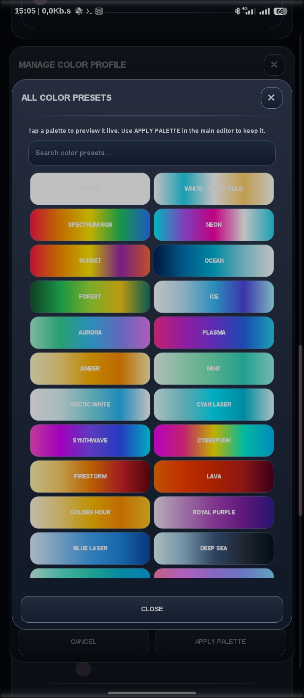

  <h1>
    
    Floating DJ Visualizer
  </h1>

  <h3>Projects Floating DJ Visualizer By Rifki</h3>

  
<i>A customizable floating audio visualizer for Android.</i>

  

    
    
    
    
  

  

    <b>Visualisasi audio Android dengan floating overlay, kustomisasi mendalam, dan kontrol visual yang fleksibel.</b>
  

---

## 📸 Preview Aplikasi

<!-- Menampilkan 6 screenshot dokumentasi dalam 2 baris (3 kolom) -->
<table align="center">
  <tr>
    <td align="center"></td>
    <td align="center"></td>
    <td align="center"></td>
  </tr>
  <tr>
    <td align="center"></td>
    <td align="center"></td>
    <td align="center"></td>
  </tr>
</table>

> *Lihat koleksi lengkap tangkapan layar lainnya di folder [dokumentasi/](dokumentasi/).*

---

## 📖 Tentang Proyek (About the Project)

**Floating DJ Visualizer** adalah proyek aplikasi Android yang dikembangkan oleh **Rifki**. Aplikasi ini menghadirkan visualisasi audio dalam bentuk *floating overlay*, sehingga visualizer dapat tetap tampil di atas aplikasi lain.

Proyek ini telah mencapai tahap akhir untuk **Versi 2** melalui rilis **V2.4.32**, dengan fokus pada fleksibilitas tampilan, sinkronisasi pengaturan, kestabilan, dan pengalaman penggunaan yang mulus. *(Versi 3 saat ini sedang dalam proses pengembangan).*

> **📱 Fun Fact:** Seluruh aplikasi ini dirancang dan dibangun **langsung dari Smartphone Android** menggunakan IDE *open-source* **[CodeAssist](https://github.com/tyron12233/CodeAssist)** buatan Tyron. Proyek ini adalah bukti nyata bahwa keterbatasan perangkat (*Mobile Coding*) bukanlah penghalang untuk menciptakan aplikasi Android yang kompleks dan profesional!

## ✨ Kelebihan Aplikasi (Key Features)

- **Floating Overlay** — Visualizer dapat tampil di atas aplikasi lain dan dipindahkan ke berbagai posisi layar.
- **Mode Visualizer** — Mendukung mode Single dan Horizontal/DJ.
- **Bar Customization** — Pengaturan jumlah bar, *gap*, ketebalan, tinggi, dan tampilan visual.
- **Real-Time Color Studio** — Album warna memiliki **100 Preset Palet**. Cukup sentuh *preset* untuk melihat pratinjaunya secara *real-time* di layar, lalu klik `Apply` untuk menyimpan atau `Cancel` untuk membatalkan.
- **Bar Appearance** — Pilihan gaya *Clean*, *Glossy*, *Neon*, dan *Frosted*.
- **Glow Effect** — Intensitas efek *glow* dapat disesuaikan dan tampil pada semua gaya visual.
- **Floating Profile & Layers** — Pengelolaan beberapa profil/layer dengan konfigurasi masing-masing (hingga 12 Floating Overlay di layar ponselmu).
- **Scene Manager** — Menyimpan dan mengelola konfigurasi visualizer sebagai *scene*.
- **Import & Export** — Dukungan pertukaran konfigurasi (*preset*) yang tersedia di aplikasi.
- **Live Preview** — Pratinjau visual secara *real-time* untuk melihat perubahan pengaturan.
- **UI Themes** — Pilihan tampilan *Glossy*, *Custom*, *System*, *Dark*, dan *Light*.
- **Position Control** — Pengaturan posisi *floating* secara horizontal maupun vertikal.

---

## 🎨 Preset Uji Coba (Test Presets)

Bagi Anda yang ingin langsung mencoba kemampuan penuh dari aplikasi ini tanpa harus mengatur dari awal, saya telah menyediakan folder **[`Test - Preset`](Test%20-%20Preset/)** di dalam repositori ini. Folder ini berisi *preset* yang sudah saya uji coba di *smartphone* saya.

*   **Preset General App:** Konfigurasi umum untuk keseluruhan aplikasi.
*   **Preset Per Scenes:** Konfigurasi spesifik untuk desain bar dan warna tertentu.

**Cara Penggunaan:** Unduh file *preset* dari folder tersebut, lalu gunakan fitur **Import** di dalam aplikasi Floating DJ Visualizer. Anda bebas menggunakan *preset* ini atau mengkustomisasinya kembali sesuai selera!

---

## 🛠️ Teknologi (Tech Stack)

| Komponen | Teknologi |
|---|---|
| **Platform** | Android |
| **Development Tool** | [CodeAssist (On-Device Mobile IDE)](https://github.com/tyron12233/CodeAssist) |
| **Bahasa Utama** | Kotlin |
| **UI** | Android Views |
| **Audio Visualization** | Android `Visualizer` API & MediaProjection FFT |
| **Build System** | Gradle / Android Build Tools |

## 📱 Kompatibilitas (Compatibility)

- Dirancang khusus untuk perangkat Android.
- Minimum SDK dan Target SDK mengikuti konfigurasi rilis (Mendukung Android 15 & Android 16).
- *Catatan: Performa dan dukungan audio (FFT/Visualizer) dapat berbeda tergantung spesifikasi perangkat keras dan implementasi vendor ROM/OS.*

---

## 📝 Changelog

> Ini adalah pembaruan terakhir (*Final Release*) untuk Versi 2.

### 🔹 V2.4.32 — The Final V2 Update (Engine & UI Overhaul)

#### 🇬🇧 English (EN)
- **Live Engine Restored:** Restored the complete v2.4.30 Display/Choreographer preview scheduling and live interpolation. Removed the v2.4.31 preview pausing, 30 FPS pacing, and parent-only invalidation changes that caused visual freezes.
- **Glow Optimization:** Reduced only the in-app Display preview glow by replacing its three-pass halo with a single smaller, lower-alpha pass, and removed redundant glow passes from live/held peak markers.
- **Renderer Integrity:** Maintained the full Floating Service glow renderer, FFT delivery, 20 Hz–20 kHz mapping, frame-synchronized animation, Single/Horizontal geometry, and overlay position/rotation logic unchanged.
- **Simultaneous Rendering:** Display and Floating renderers now run simultaneously without scroll-triggered pauses or Display frame caps.
- **Live Hz Tracking:** The Live Hz tracking display now dynamically adjusts per bar line, following the total bar count configuration.
- **Real-Time Color Studio:** The UI Preset color album now features **100 color presets**. Tapping a preset instantly applies a live preview to the visualizer. Click `Apply` to keep it or `Cancel` to revert!
- **Profile Expansion:** Redesigned the Floating Profile UI, allowing up to 1/12 Floating Overlays directly on your screen.
- **General Polish:** Refined app UX/UI design for maximum neatness. Bumped version to 2.4.32 / versionCode 61.

#### 🇮🇩 Indonesia (ID)
- **Pemulihan Live Engine:** Mengembalikan penjadwalan *Display/Choreographer preview* dan interpolasi langsung dari v2.4.30 secara penuh. Menghapus jeda *preview*, pembatasan 30 FPS, dan masalah *invalidation* dari v2.4.31 yang menyebabkan tampilan macet (*frozen*).
- **Optimasi Efek Glow:** Mengurangi efek *glow* hanya pada pratinjau (*preview*) di dalam aplikasi: mengganti tiga lapis halo dengan satu lapis *alpha* rendah, serta menghapus *glow* berlebih pada penanda puncak (*peak markers*).
- **Integritas Renderer:** Mempertahankan secara utuh fitur *glow renderer* pada Floating Service, pengiriman FFT, pemetaan 20 Hz–20 kHz, animasi sinkron-bingkai, geometri Single/Horizontal, serta logika posisi/rotasi *overlay*.
- **Rendering Simultan:** *Renderer* pratinjau (Display) dan Floating kini berjalan bersamaan tanpa jeda saat menggulir layar (*scroll*) atau pembatasan *frame*.
- **Live Hz Tracking:** Pelacakan Live Hz kini otomatis menyesuaikan tampilannya pada setiap garis mengikuti jumlah bar yang diatur.
- **Real-Time Color Studio:** Album warna kini dilengkapi dengan **100 Preset Palet**. Cukup tekan *preset* di album, dan pratinjau warna akan langsung berubah secara *real-time*. Klik `Apply` untuk menyimpan, atau `Cancel/Silang` jika ingin membatalkan.
- **Ekspansi Profil:** Desain UI *Floating Profile* baru yang memungkinkan kamu memasang hingga 12 *Floating Overlay* aktif bersamaan di layar HP-mu.
- **Penyempurnaan Umum:** Desain UI/UX aplikasi dirapikan menjadi lebih maksimal. Versi ditingkatkan ke 2.4.32 / versionCode 61.

---
*(Untuk melihat log pembaruan versi sebelumnya seperti v2.3.3, v2.2.3, dan v1.x, silakan cek halaman rilis repositori ini).*
---

## 📬 Contact & Collaboration

Punya pertanyaan, masukan, ide pengembangan, atau tertarik untuk berkolaborasi? / *Have questions, feedback, or want to collaborate?*

  

  <b>Email:</b> <a href="mailto:rifki.work74@outlook.com">rifki.work74@outlook.com</a>

---

  <b>Made with passion by Rifki</b> 🎧
    
  <i>Floating DJ Visualizer — Visualize Your Sound.</i>

