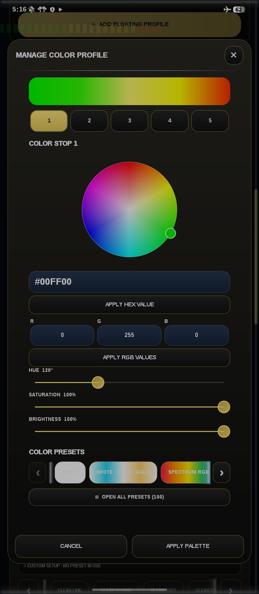
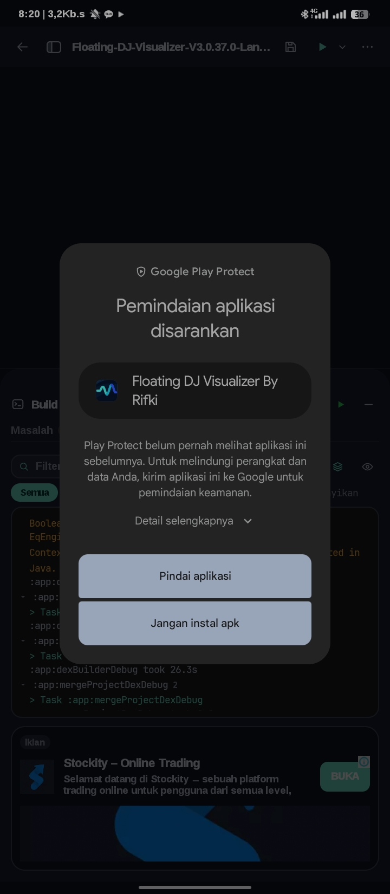
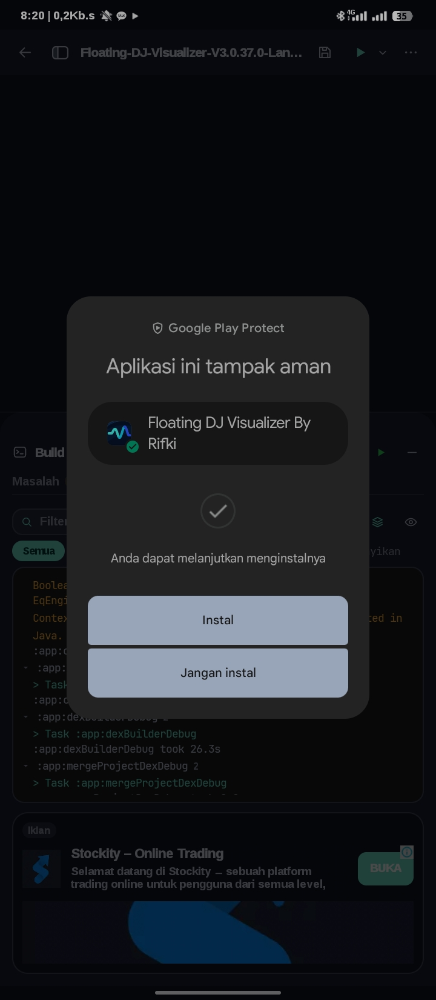



<h1>
  
  Floating DJ Visualizer
</h1>

### Android Floating Audio Visualizer &amp; Experimental Equalizer

**Developed by Rifki**

  
  
  
  
  

**Visualize your sound. Customize every layer.**

  <strong>&#127468;&#127463; EN</strong> — A customizable, audio-reactive floating visualizer with independent layers, reusable scenes, Theme Studio, live profile-aware previews, and an experimental device-dependent Equalizer Engine.
   
  <strong>&#127470;&#127465; ID</strong> — Floating visualizer responsif yang dapat dikustomisasi dengan layer independen, scene yang dapat digunakan kembali, Theme Studio, pratinjau profile secara langsung, serta Equalizer Engine eksperimental yang bergantung pada perangkat.

  <a href="#app-preview">Preview</a> &middot;
  <a href="#about">About</a> &middot;
  <a href="#key-features">Features</a> &middot;
  <a href="#installation">Installation</a> &middot;
  <a href="#repository-guide">Repository</a> &middot;
  <a href="#compatibility">Compatibility</a> &middot;
  <a href="#audio-processing-notes">Audio Notes</a> &middot;
  <a href="#changelog">Changelog</a> &middot;
  <a href="app/CHANGELOG.md">Full Changelog</a> &middot;
  <a href="#contact">Contact</a>

---

## Contents | Daftar Isi

- [App Preview | Pratinjau Aplikasi](#app-preview)
- [About | Tentang Proyek](#about)
- [Key Features | Fitur Utama](#key-features)
- [Installation | Instalasi](#installation)
- [Repository Guide | Struktur Repository](#repository-guide)
  - [📸 Screenshot Gallery](dokumentasi/)
  - [🧪 Test Presets](Test-Preset/)
  - [📚 Technical Documentation](docs/)
  - [📜 Complete Changelog](app/CHANGELOG.md)
- [Test Presets | Preset Uji Coba](#test-presets)
- [Technology Stack | Teknologi](#technology-stack)
- [Compatibility | Kompatibilitas](#compatibility)
- [Audio Processing Notes | Catatan Audio](#audio-processing-notes)
- [Development History & Changelog](#changelog)
- [Contact | Kontak](#contact)

---

## App Preview | Pratinjau Aplikasi

Tap any image to open its full-size version. / Ketuk gambar untuk membuka ukuran penuh.

<table align="center" width="100%">
  <tr>
    <td align="center" width="25%" style="padding: 10px 8px;"></td>
    <td align="center" width="25%" style="padding: 10px 8px;"></td>
    <td align="center" width="25%" style="padding: 10px 8px;"></td>
    <td align="center" width="25%" style="padding: 10px 8px;"></td>
  </tr>
  <tr>
    <td align="center" width="25%" style="padding: 10px 8px;"></td>
    <td align="center" width="25%" style="padding: 10px 8px;"></td>
    <td align="center" width="25%" style="padding: 10px 8px;"></td>
    <td align="center" width="25%" style="padding: 10px 8px;"></td>
  </tr>
</table>

  <strong>📸 More screenshots &amp; visual documentation</strong> 
  This homepage preview intentionally shows only eight selected images. Open the <a href="dokumentasi/">📂 <code>dokumentasi/</code> folder</a> to browse the complete screenshot collection and additional visual references. Screenshot image files in this folder use the <code>.jpg</code> format. 
  <strong>📸 Dokumentasi visual lainnya</strong> 
  Pratinjau halaman utama ini sengaja menampilkan delapan gambar pilihan saja. Buka <a href="dokumentasi/">📂 folder <code>dokumentasi/</code></a> untuk menjelajahi seluruh koleksi screenshot dan referensi visual tambahan. File gambar screenshot di folder ini menggunakan format <code>.jpg</code>.

---

## About | Tentang Proyek

**&#127468;&#127463; English**

Floating DJ Visualizer is an Android application developed by **Rifki**. It began as a floating audio visualizer and has evolved into a layered visual workspace for real-time audio-reactive displays. The application includes independent floating profiles, per-layer controls, reusable scenes, appearance customization, profile-aware Live Spectrum previews, and an additional experimental Equalizer Engine.

The project is developed directly on an Android device using the open-source [CodeAssist IDE](https://github.com/tyron12233/CodeAssist).

**&#127470;&#127465; Bahasa Indonesia**

Floating DJ Visualizer adalah aplikasi Android yang dikembangkan oleh **Rifki**. Berawal dari floating audio visualizer, proyek ini berkembang menjadi workspace visual berlapis yang merespons audio secara real-time. Aplikasi menyediakan floating profile independen, kontrol setiap layer, scene yang dapat digunakan kembali, kustomisasi tampilan, pratinjau Live Spectrum sesuai profile, serta Equalizer Engine tambahan yang masih bersifat eksperimental.

Proyek ini dikembangkan langsung melalui perangkat Android menggunakan [CodeAssist IDE](https://github.com/tyron12233/CodeAssist) yang bersifat open-source.

> **Current version / Versi saat ini:** `3.0.38.2` (`versionCode 126`). The Equalizer Engine remains experimental and device-dependent. / Equalizer Engine masih bersifat eksperimental dan bergantung pada perangkat.

---

## Key Features | Fitur Utama

### 1. Audio Visualization | Visualisasi Audio

| Feature | &#127468;&#127463; English | &#127470;&#127465; Bahasa Indonesia |
|---|---|---|
| **Floating Overlay** | Displays the visualizer above other apps after the required overlay permission is granted. | Menampilkan visualizer di atas aplikasi lain setelah izin overlay diberikan. |
| **Visualizer Modes** | Supports Single and Horizontal / DJ layouts. | Mendukung layout Single dan Horizontal / DJ. |
| **Bar Controls** | Configure supported bar properties such as count, width, height, thickness, gap, scale, opacity, glow, and corner shape. | Mengatur properti bar yang didukung seperti jumlah, lebar, tinggi, ketebalan, jarak, skala, opacity, glow, dan bentuk sudut. |
| **Frequency Display** | Shows frequency ranges and activity levels for the selected visualization mode. | Menampilkan rentang frekuensi dan level aktivitas sesuai mode visualisasi yang dipilih. |
| **Appearance Styles** | Clean, Glossy, Neon, and Frosted styles with editable color profiles. | Gaya Clean, Glossy, Neon, dan Frosted dengan profile warna yang dapat diedit. |
| **Position Studio** | Controls the position, movement, and rotation of floating layers. | Mengatur posisi, pergerakan, dan rotasi floating layer. |

### 2. Visual Studio &amp; Workflow | Studio Visual &amp; Alur Kerja

| Feature | &#127468;&#127463; English | &#127470;&#127465; Bahasa Indonesia |
|---|---|---|
| **Theme Studio** | Glossy, Custom, System, Dark, and Light interface themes. | Tema antarmuka Glossy, Custom, System, Dark, dan Light. |
| **Floating Profiles &amp; Layers** | Manage independent layers, select profiles, and change layer order. | Mengelola layer independen, memilih profile, dan mengubah urutan layer. |
| **Linked Controls** | Link supported parameters across compatible layers with mode-aware target handling. | Menghubungkan parameter yang didukung ke beberapa layer kompatibel dengan pemeriksaan mode. |
| **Copy To** | Copy supported profile or appearance settings to another layer. | Menyalin pengaturan profile atau tampilan yang didukung ke layer lain. |
| **Scene Manager** | Save, load, update, rename, delete, import, and export floating scenes. | Menyimpan, memuat, memperbarui, mengganti nama, menghapus, mengimpor, dan mengekspor scene floating. |
| **Color Album** | Browse built-in bar-color presets and preview supported palette choices. | Menjelajahi preset warna bar bawaan dan melihat pratinjau palet yang didukung. |
| **Live Preview** | Preview profile and display changes while editing, with profile-aware mode and frequency information. | Melihat perubahan profile dan display saat mengedit, termasuk informasi mode dan frekuensi sesuai profile. |
| **Global Audio Analysis** | Provides shared FFT and Hop settings for the audio-analysis engine. | Menyediakan pengaturan FFT dan Hop global untuk engine analisis audio. |
| **General Import / Export** | Back up and restore supported settings, profiles, scenes, and EQ data with validation and import review. Runtime permissions and active engines are not transferred or auto-started. | Mencadangkan dan memulihkan pengaturan, profile, scene, serta data EQ yang didukung melalui validasi dan tinjauan impor. Izin runtime dan engine aktif tidak ikut dipindahkan atau dijalankan otomatis. |
| **Notification Controls** | Provides theme-aware controls for supported visualizer and EQ actions. | Menyediakan kontrol notifikasi yang mengikuti tema untuk fungsi visualizer dan EQ yang didukung. |

### 3. Experimental Equalizer Engine | Equalizer Eksperimental

| Feature | &#127468;&#127463; English | &#127470;&#127465; Bahasa Indonesia |
|---|---|---|
| **Adaptive EQ Bands** | Shows supported band layouts detected by the active backend, including 5-band or 10-band configurations where available. | Menampilkan susunan band yang terdeteksi pada backend aktif, termasuk konfigurasi 5-band atau 10-band jika tersedia. |
| **Band Analyzer &amp; Presets** | Reports detected band capabilities and filters built-in presets to matching band counts. | Menampilkan kemampuan band yang terdeteksi dan menyaring preset bawaan berdasarkan jumlah band yang sesuai. |
| **Band Editing** | Provides vertical faders, direct dB input, and individual band reset. | Menyediakan fader vertikal, input dB langsung, dan reset setiap band. |
| **Additional Effects** | Bass Boost, Virtualizer, and Limiter controls where supported by the device and backend. | Kontrol Bass Boost, Virtualizer, dan Limiter sesuai dukungan perangkat dan backend. |
| **EQ Preset Import / Export** | Imports and exports supported EQ preset files. | Mengimpor dan mengekspor file preset EQ yang didukung. |

---

## Installation | Instalasi

### Before installing | Sebelum instalasi

**&#127468;&#127463; English**

Floating DJ Visualizer is currently distributed through GitHub Releases and is **not listed on Google Play**. Android or Google Play Protect may therefore display an unknown-source, unverified-app, or scanning notice when an APK is installed outside Google Play.

A warning should be read carefully. It does not automatically prove that an app is malicious, but it must not be ignored. The developer cannot guarantee that every device or security scanner will classify every build in the same way.

**&#127470;&#127465; Bahasa Indonesia**

Floating DJ Visualizer saat ini didistribusikan melalui GitHub Releases dan **belum tersedia di Google Play**. Karena APK dipasang dari luar Google Play, Android atau Google Play Protect mungkin menampilkan pemberitahuan sumber tidak dikenal, aplikasi belum terverifikasi, atau permintaan pemindaian.

Setiap peringatan harus dibaca dengan teliti. Peringatan tersebut tidak otomatis membuktikan bahwa aplikasi berbahaya, tetapi juga tidak boleh diabaikan. Pengembang tidak dapat menjamin bahwa setiap perangkat atau pemindai keamanan akan memberikan klasifikasi yang sama untuk setiap build.

### Step 1 — Download from the official release page | Langkah 1 — Unduh dari halaman rilis resmi

1. Open the project's [GitHub Releases page](https://github.com/rifkiwork74/Projects-Floating-DJ-Visualizer-By-Rifki/releases).
2. Select the release you intend to install and read its release notes.
3. Download the APK asset published on that release page. Avoid APKs from unofficial mirrors or unknown re-uploaders.

1. Buka halaman [GitHub Releases resmi proyek](https://github.com/rifkiwork74/Projects-Floating-DJ-Visualizer-By-Rifki/releases).
2. Pilih rilis yang ingin dipasang dan baca release notes-nya.
3. Unduh file APK yang tersedia pada halaman rilis tersebut. Hindari APK dari mirror tidak resmi atau pengunggah yang tidak dikenal.

### Step 2 — Check the APK | Langkah 2 — Periksa APK

**EN:** Before opening the APK, check that it came from the official repository, confirm the release version, and review any published checksum or signing-certificate information. A matching digital signature helps confirm that an APK was signed by the same signing key as the reference release; it does **not** prove that the application is harmless or independently audited.

**ID:** Sebelum membuka APK, pastikan file berasal dari repository resmi, cocokkan versi rilis, dan periksa checksum atau informasi sertifikat tanda tangan apabila tersedia. Tanda tangan digital yang cocok membantu memastikan APK ditandatangani menggunakan signing key yang sama dengan rilis pembanding; tanda tangan tersebut **bukan** bukti bahwa aplikasi pasti aman atau telah diaudit secara independen.

### Step 3 — Install through Android | Langkah 3 — Instal melalui Android

1. Open the downloaded APK using your browser's download list or the device's file manager.
2. If Android asks for permission to install apps from that source, review the prompt. Allow the source only when you have verified that the APK came from the official release page and you intend to install it.
3. Return to the installer and follow the Android installation prompts.
4. After installation, consider disabling the temporary **Allow from this source** permission again.

1. Buka APK yang telah diunduh melalui daftar unduhan browser atau file manager perangkat.
2. Jika Android meminta izin untuk memasang aplikasi dari sumber tersebut, baca pemberitahuannya. Izinkan sumber hanya setelah memastikan APK berasal dari halaman rilis resmi dan kamu memang ingin memasangnya.
3. Kembali ke installer dan ikuti petunjuk instalasi Android.
4. Setelah instalasi selesai, pertimbangkan untuk menonaktifkan kembali izin sementara **Izinkan dari sumber ini**.

### Step 4 — If Play Protect displays a warning | Langkah 4 — Jika Play Protect menampilkan peringatan

**EN:** Let Play Protect complete its scan and read the exact result. If it reports the APK as harmful, blocks installation, or the source/signature cannot be verified, cancel the installation and keep Play Protect enabled. Do not disable security scanning, turn off mobile data to avoid a check, or force an installation past a harmful-app warning. You can report the warning to the developer so the release can be reviewed.

**ID:** Biarkan Play Protect menyelesaikan pemindaian dan baca hasilnya secara lengkap. Jika APK dinyatakan berbahaya, instalasi diblokir, atau sumber/tanda tangannya tidak dapat diverifikasi, batalkan instalasi dan biarkan Play Protect tetap aktif. Jangan menonaktifkan pemindaian keamanan, mematikan data seluler untuk menghindari pemeriksaan, atau memaksakan instalasi melewati peringatan aplikasi berbahaya. Kamu dapat mengirimkan informasi peringatan tersebut kepada pengembang agar rilisnya dapat ditinjau.

### Step 5 — Grant only the permissions you need | Langkah 5 — Berikan izin seperlunya

**EN:** The floating overlay requires Android's display-over-other-apps permission. Audio visualization or capture features may request audio-related or MediaProjection access depending on the selected mode and Android version. Review each system dialog and grant only the permissions needed for the features you intend to use. You can revoke permissions later from Android Settings.

**ID:** Floating overlay memerlukan izin Android untuk tampil di atas aplikasi lain. Fitur visualisasi atau capture audio dapat meminta akses terkait audio atau MediaProjection sesuai mode yang dipilih dan versi Android. Periksa setiap dialog sistem dan berikan hanya izin yang diperlukan untuk fitur yang ingin digunakan. Izin dapat dicabut kembali melalui Pengaturan Android.

---

## Test Presets | Preset Uji Coba

**&#127468;&#127463; English**

Example configurations from development and testing may be available in [`Test-Preset/`](Test-Preset/). Use files compatible with your application version and review their contents before applying them.

**&#127470;&#127465; Bahasa Indonesia**

Contoh konfigurasi dari proses pengembangan dan pengujian dapat tersedia di folder [`Test-Preset/`](Test-Preset/). Gunakan file yang sesuai dengan versi aplikasi dan periksa isinya sebelum diterapkan.

---

## Repository Guide | Panduan Struktur Repository

The root `README.md` is rendered automatically on the GitHub repository homepage. It displays eight curated screenshots, while the linked `dokumentasi/` directory provides access to the larger JPG collection. GitHub lists newly committed files in that folder automatically; adding a new image does not require embedding every image into this homepage.

File `README.md` di root repository akan ditampilkan otomatis pada halaman utama repository GitHub. README ini menampilkan delapan screenshot pilihan, sedangkan folder `dokumentasi/` yang ditautkan menyediakan akses ke koleksi JPG yang lebih lengkap. GitHub akan menampilkan file baru yang di-commit ke folder tersebut secara otomatis; gambar tambahan tidak perlu dimasukkan satu per satu ke halaman utama.

| Path | What you will find / Isi folder atau file |
|---|---|
| 📸 [**`dokumentasi/`**](dokumentasi/) | Additional application screenshots, visual documentation, and image references. / Screenshot aplikasi, dokumentasi visual, dan referensi gambar lainnya. |
| 🧪 [**`Test-Preset/`**](Test-Preset/) | Test configurations and preset files used for development or experimentation. Check compatibility before importing. / Konfigurasi pengujian dan file preset untuk pengembangan atau eksperimen. Periksa kompatibilitas sebelum mengimpor. |
| 📚 [**`docs/`**](docs/) | Supplementary technical documents, implementation notes, and version-specific update records. / Dokumen teknis tambahan, catatan implementasi, dan catatan pembaruan versi tertentu. |
| 📱 [**`app/`**](app/) | Android application module, including source code, resources, and app configuration. / Modul aplikasi Android, termasuk source code, resource, dan konfigurasi aplikasi. |
| 🧾 [**`app/CHANGELOG.md`**](app/CHANGELOG.md) | The detailed, cumulative development changelog. Use this file for the fuller version-by-version history beyond the summary in this README. / Changelog pengembangan kumulatif yang lebih lengkap. Buka file ini untuk melihat riwayat versi lebih mendalam di luar ringkasan README. |
| ⚙️ [**`.platform/`**](.platform/) | Platform-specific project configuration and metadata. / Konfigurasi khusus platform dan metadata proyek. |
| 📄 [**`LICENSE`**](LICENSE) | Project license and usage terms. / Lisensi proyek dan ketentuan penggunaannya. |

**About `.git/`:** this is Git's internal local metadata directory. It is normally managed by Git itself and is not presented as a regular browsable project folder on GitHub. / **Tentang `.git/`:** folder ini berisi metadata internal Git di perangkat lokal. Folder tersebut dikelola oleh Git dan biasanya tidak ditampilkan sebagai folder proyek yang dapat dijelajahi di GitHub.

---

## Technology Stack | Teknologi

| Component | Technology |
|---|---|
| Platform | Android |
| Main language | Kotlin |
| Development IDE | [CodeAssist](https://github.com/tyron12233/CodeAssist) |
| UI framework | Android Views |
| Audio visualization | Android `Visualizer` API and optional MediaProjection PCM analysis |
| Equalizer | Android audio effects and `DynamicsProcessing` where supported |
| Build tools | Gradle and Android Build Tools |

---

## Compatibility | Kompatibilitas

| Item | Configuration |
|---|---|
| Minimum Android | Android 8.0 (API 26) |
| Target SDK | API 36 |
| Package name | `com.floatingdj.visualizer` |
| Version | `3.0.38.2` (`versionCode 126`) |
| Device | Android phones and compatible devices |
| Floating Overlay | Requires the user's Android **Display over other apps** permission. / Memerlukan izin Android **Tampilkan di atas aplikasi lain**. |
| Audio effects | Availability and control vary by device, ROM, player, and active audio route. / Ketersediaan dan kontrol bergantung pada perangkat, ROM, player, dan jalur audio aktif. |

---

## Audio Processing Notes | Catatan Pemrosesan Audio

**&#127468;&#127463; English**

The Equalizer Engine is experimental and device-dependent. The Android output-mix route is not a universal per-player or system-wide mixer. Effect availability, band count, and control behavior may vary by Android version, manufacturer implementation, and active audio route. Detecting an effect does not guarantee that every application or audio route is processed. Some effects require a compatible player-owned audio session.

For MediaProjection PCM analysis, FFT and Hop describe analysis-window and sampling-step behavior; they are not a guarantee of end-to-end screen latency. Actual visual response also depends on device performance, capture scheduling, audio routing, and display refresh behavior.

**&#127470;&#127465; Bahasa Indonesia**

Equalizer Engine masih eksperimental dan bergantung pada perangkat. Jalur output-mix Android bukan mixer universal per-player atau mixer seluruh sistem. Ketersediaan efek, jumlah band, dan perilaku kontrol dapat berbeda menurut versi Android, implementasi produsen, serta jalur audio aktif. Efek yang terdeteksi tidak menjamin seluruh aplikasi atau jalur audio ikut diproses. Beberapa efek memerlukan audio session milik player yang kompatibel.

Pada analisis PCM MediaProjection, FFT dan Hop menjelaskan perilaku jendela analisis dan langkah sampling; keduanya bukan jaminan latency visual dari awal hingga layar. Respons visual aktual juga dipengaruhi performa perangkat, penjadwalan capture, routing audio, dan refresh rate layar.

---

## Development History &amp; Changelog | Riwayat Pengembangan

This summary covers the documented development line from **V3.0.20.0 through V3.0.38.2**. It groups related work into milestones so the history remains readable without losing the major changes.

Ringkasan ini mencakup lini pengembangan yang terdokumentasi dari **V3.0.20.0 sampai V3.0.38.2**. Perubahan yang saling berkaitan dikelompokkan menjadi beberapa milestone agar riwayat tetap mudah dibaca tanpa menghilangkan pembaruan utama.

> 📜 **Full changelog / Changelog lengkap:** [Open `app/CHANGELOG.md`](app/CHANGELOG.md) for the complete, cumulative, version-by-version development record. This README keeps a shorter curated overview for visitors.
>
> 📜 **Riwayat lengkap:** [Buka `app/CHANGELOG.md`](app/CHANGELOG.md) untuk melihat catatan pengembangan kumulatif dan perubahan setiap versi secara lebih terperinci. README ini tetap menyediakan ringkasan pilihan agar pengunjung lebih mudah membaca perkembangan utama.

  
  

### V3.0.38.2 — Latest | Terbaru

**Exact Display Gap &amp; Symmetric Header Beam Transitions** · `versionCode 126`

- **Display geometry parity:** Single-mode segment gaps, minimum segment height, and corner radius now scale with the selected Floating layer's fitted height. Horizontal-mode thickness and gap use the same viewport-fit ratio, with glow inset accounted for before layout margins are calculated.
- **Smoother title loop:** Header-beam reveal and exit use matching 200 ms quintic easing. The beam grows from 10% to full length, then contracts to 10% while fading out, creating a matching loop seam.
- **Rotation preserved:** The 8.0-second cycle, bloom/rotation boundary, clockwise entry spin, overlapping endpoint counter-turn, travel positions, and endpoint timing remain unchanged.
- **Version metadata:** Module and Android manifest metadata now report `3.0.38.2` / `126`.
- **Preserved systems:** Audio capture, MediaProjection PCM, FFT/Hop, EQ DSP, profiles, scenes, floating renderer, and notification controls are retained.

**ID**
- **Kesamaan geometri Display:** Gap segmen mode Single, tinggi minimum segmen, dan radius sudut kini mengikuti skala tinggi Floating layer yang dipilih. Pada mode Horizontal, thickness dan gap menggunakan rasio penyesuaian viewport yang sama, dengan inset glow dihitung sebelum margin layout ditentukan.
- **Loop judul lebih halus:** Kemunculan dan akhir header beam menggunakan easing quintic 200 ms yang seimbang. Garis tumbuh dari 10% ke ukuran penuh, lalu mengecil kembali ke 10% sambil memudar agar sambungan loop lebih konsisten.
- **Rotasi dipertahankan:** Siklus 8 detik, batas bloom/rotasi, putaran masuk searah jarum jam, counter-turn endpoint yang overlap, posisi pergerakan, dan waktu endpoint tidak diubah.
- **Metadata versi:** Metadata module dan Android manifest kini menunjukkan `3.0.38.2` / `126`.
- **Sistem yang dipertahankan:** Audio capture, MediaProjection PCM, FFT/Hop, EQ DSP, profile, scene, floating renderer, dan kontrol notifikasi tetap dipertahankan.

### V3.0.38.0–V3.0.38.1 — Display Parity &amp; Hold Navigator

- Matched Live Display geometry more closely to the active Floating renderer, including thickness, gap, glow reservation, split margins, and responsive canvas behavior.
- Made Live Preview frequency labels and mode information follow the selected preview profile. Removed the profile picker from Global Audio Analysis because FFT/Hop are shared engine settings; the Response Engine remains profile-aware.
- Refined portrait/landscape canvas dimensions, header spacing, and the section navigator's 1.5-second hold interaction with an expanding glass ring.
- Fixed the missing `expandingWindowPaint` declaration and rendered the hold effect as a bounded outer ring rather than a filled circle.

**ID**
- Menyamakan geometri Live Display dengan Floating renderer aktif, termasuk thickness, gap, glow reservation, split margin, dan perilaku canvas responsif.
- Membuat label frekuensi serta informasi mode Live Preview mengikuti profile yang dipilih. Pemilih profile di Global Audio Analysis dihapus karena FFT/Hop merupakan pengaturan engine bersama; Response Engine tetap mengikuti profile.
- Merapikan ukuran canvas portrait/landscape, jarak header, serta interaksi hold navigator 1,5 detik dengan glass ring yang mengembang.
- Memperbaiki deklarasi `expandingWindowPaint` yang hilang dan menggambar efek hold sebagai ring luar yang dibatasi, bukan lingkaran penuh.

### V3.0.35.0–V3.0.37.0 — Responsive Display &amp; Audio Tracking

- Refined the title's continuous endpoint turn and synchronized beam travel/rotation. Improved horizontal Live Display geometry and reduced preview drawing allocations through buffer and geometry reuse.
- Added Projection Horizontal local-peak retention per logarithmic frequency window and expanded PCM diagnostics with low/mid/high average and peak values.
- Expanded the Horizontal preview across the available landscape viewport, introduced a stable preview canvas, and separated Response Engine and Global Audio Analysis into dedicated cards.

**ID**
- Merapikan endpoint turn judul yang berkesinambungan serta sinkronisasi pergerakan dan rotasi beam. Geometri Live Display Horizontal ditingkatkan dan alokasi saat menggambar preview dikurangi melalui penggunaan ulang buffer dan geometri.
- Menambahkan local-peak retention pada Projection Horizontal untuk setiap jendela frekuensi logaritmik serta memperluas diagnostik PCM dengan nilai rata-rata dan puncak low/mid/high.
- Memperluas preview Horizontal agar mengisi viewport landscape yang tersedia, menghadirkan canvas preview stabil, serta memisahkan Response Engine dan Global Audio Analysis ke dalam kartu khusus.

### V3.0.30.0–V3.0.34.0 — Navigation, Title Motion &amp; Layout Refinement

- Introduced a floating section navigator with tap-to-next-section and hold-to-bottom behavior, progress feedback, and theme-aware glass styling.
- Iterated on the title animation, including one-way beam travel, endpoint counter-turn, per-glyph impact, synchronized gradient motion, and loop-state restoration.
- Improved profile drag/reorder behavior, section anchors, landscape scrolling, linked-control layouts, and studio-dialog scrolling. V3.0.34.0 also included a Kotlin layout-parameter compile repair.

**ID**
- Menghadirkan section navigator mengambang dengan fungsi tap untuk berpindah ke bagian berikutnya dan hold untuk menuju bagian bawah, dilengkapi indikator progress serta glass styling sesuai tema.
- Menyempurnakan animasi judul, termasuk pergerakan beam satu arah, counter-turn di endpoint, efek per-huruf, gerakan gradient yang sinkron, dan pemulihan state loop.
- Meningkatkan perilaku drag/reorder profile, section anchor, scrolling landscape, layout kontrol Linked, dan scrolling studio dialog. V3.0.34.0 juga mencakup perbaikan compile Kotlin pada layout parameter.

### V3.0.25.0–V3.0.29.0 — Visual Identity &amp; Layer Workflow

- Refined Light-theme boundaries and slider contrast, introduced the cyan-to-blue Glossy palette, and added kinetic per-letter title impact.
- Updated adaptive and legacy launcher artwork, refined title geometry and glyph synchronization, and improved workspace identity.
- Added Linked Response Mode propagation and smoother, screen-coordinate-aware layer drag/reorder behavior.

**ID**
- Merapikan batas panel dan kontras slider pada tema Light, memperbarui palet Glossy cyan-to-blue, serta menambahkan efek kinetik pada setiap huruf judul.
- Memperbarui artwork launcher adaptive dan legacy, menyempurnakan geometri judul dan sinkronisasi efek huruf, serta merapikan identitas workspace.
- Menambahkan propagasi Linked Response Mode dan meningkatkan drag/reorder layer agar lebih halus serta akurat terhadap koordinat layar.

### V3.0.20.0–V3.0.24.0 — Pinned Header, Response Controls &amp; Title Animation

- Added a pinned glass header, theme-aware title sweep, scroll-edge glass feedback, and viewport-aligned scroll rail.
- Introduced Advanced Attack/Release controls with per-profile persistence, Normal/Advanced Response modes, and live time-constant readouts.
- Refined the title into a bloom-to-slash sequence with header-relative motion, clipping protection, horizontal movement, and synchronized title transforms.

**ID**
- Menambahkan pinned glass header, title sweep yang mengikuti tema, feedback glass pada batas scrolling, dan scroll rail yang mengikuti viewport.
- Menghadirkan kontrol Advanced Attack/Release dengan penyimpanan per-profile, mode Response Normal/Advanced, serta tampilan nilai time constant secara langsung.
- Menyempurnakan judul menjadi animasi bloom-to-slash dengan pergerakan relatif terhadap header, perlindungan clipping, gerakan horizontal, dan transformasi judul yang tersinkron.

> **History note / Catatan riwayat:** The archived project changelog contains no separate V3.0.28.0 heading. This README therefore does not invent a dedicated V3.0.28.0 change entry. / Arsip changelog proyek tidak memiliki heading V3.0.28.0 secara terpisah. Karena itu README ini tidak mengarang catatan khusus untuk V3.0.28.0.

---

## Contact | Kontak

**&#127468;&#127463; English:** Feedback, bug reports, suggestions, and collaboration inquiries are welcome.

**&#127470;&#127465; Indonesia:** Masukan, laporan bug, saran, dan pertanyaan kolaborasi dipersilakan.

  

  <strong>Made with passion by Rifki</strong> 
  <em>Floating DJ Visualizer — Visualize Your Sound.</em>

