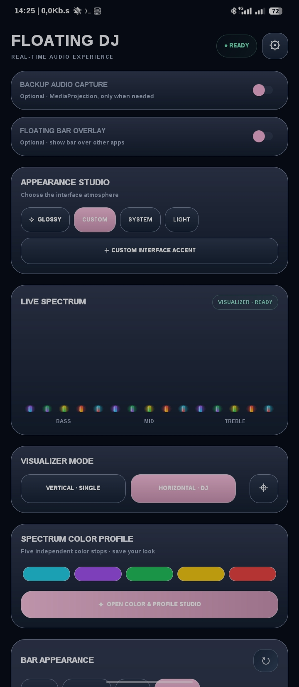
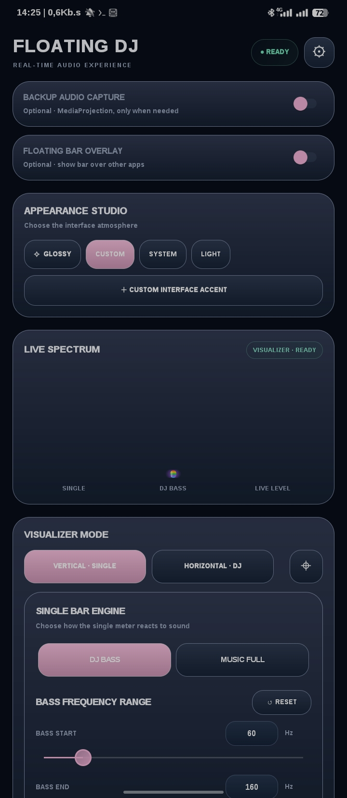
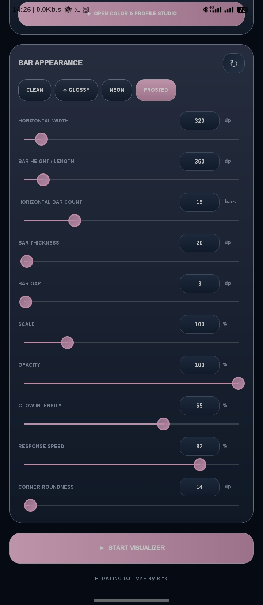
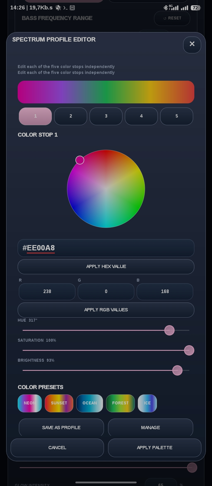

  <h1>
    
    Floating DJ Visualizer
  </h1>

  <h3>Projects Floating DJ Visualizer By Rifki</h3>

  
<i>A customizable floating audio visualizer for Android.</i>

  

    
    
    
  

  

    <b>Visualisasi audio Android dengan floating overlay, kustomisasi mendalam, dan kontrol visual yang fleksibel.</b>
  

---

## 📸 Preview Aplikasi

<table align="center">
  <tr>
    <td align="center"></td>
    <td align="center"></td>
    <td align="center"></td>
    <td align="center"></td>
  </tr>
</table>

> *Lihat koleksi lengkap tangkapan layar lainnya di folder [dokumentasi/](dokumentasi/).*

---

## 📖 Tentang Proyek (About the Project)

**Floating DJ Visualizer** adalah proyek aplikasi Android yang dikembangkan oleh **Rifki**. Aplikasi ini menghadirkan visualisasi audio dalam bentuk *floating overlay*, sehingga visualizer dapat tetap tampil di atas aplikasi lain.

Proyek ini dikembangkan secara bertahap dari **V1 hingga seterusnya**, dengan fokus pada fleksibilitas tampilan, sinkronisasi pengaturan, kestabilan, dan pengalaman penggunaan yang mulus.

## ✨ Kelebihan Aplikasi (Key Features)

- **Floating Overlay** — Visualizer dapat tampil di atas aplikasi lain dan dipindahkan ke berbagai posisi layar.
- **Mode Visualizer** — Mendukung mode Single dan Horizontal/DJ.
- **Bar Customization** — Pengaturan jumlah bar, *gap*, ketebalan, tinggi, dan tampilan visual.
- **Color Studio** — Pengaturan warna melalui *color stop*, *color wheel*, nilai HEX/RGB, dan preset palet.
- **Bar Appearance** — Pilihan gaya *Clean*, *Glossy*, *Neon*, dan *Frosted*.
- **Glow Effect** — Intensitas efek *glow* dapat disesuaikan dan tampil pada semua gaya visual.
- **Floating Profile & Layers** — Pengelolaan beberapa profil/layer dengan konfigurasi masing-masing.
- **Scene Manager** — Menyimpan dan mengelola konfigurasi visualizer sebagai *scene*.
- **Import & Export** — Dukungan pertukaran konfigurasi yang tersedia di aplikasi.
- **Live Preview** — Pratinjau visual untuk melihat perubahan pengaturan.
- **UI Themes** — Pilihan tampilan *Glossy*, *Custom*, *System*, *Dark*, dan *Light*.
- **Position Control** — Pengaturan posisi *floating* secara horizontal maupun vertikal.

> **Catatan / Note:**  
> Ketersediaan fitur dapat berbeda pada setiap versi. Periksa *changelog* untuk mengetahui fitur yang tersedia pada rilis tertentu.  
> *(Feature availability may vary by version. Check the changelog to see which features are available in a specific release.)*

## 🛠️ Teknologi (Tech Stack)

| Komponen | Teknologi |
|---|---|
| **Platform** | Android |
| **Bahasa Utama** | Kotlin |
| **UI** | Android Views |
| **Audio Visualization** | Android `Visualizer` API & MediaProjection FFT |
| **Build System** | Gradle / Android Build Tools |

## 📱 Kompatibilitas (Compatibility)

- Dirancang khusus untuk perangkat Android.
- Minimum SDK dan Target SDK mengikuti konfigurasi rilis (Mendukung Android 15 & Android 16).
- *Catatan: Performa dan dukungan audio (FFT/Visualizer) dapat berbeda tergantung spesifikasi perangkat keras dan implementasi vendor ROM/OS.*

---

## 📝 Changelog

> Catatan perubahan setiap versi akan ditambahkan secara bertahap.

### 🔹 V2.3.3 — Overlay Stability Update

#### 🇬🇧 English (EN)
- **Centered & Locked Studio Dialogs:** Disabled dialog dragging completely; every studio dialog stays centered and can only be closed with its in-panel close control or action buttons.
- **Touch & Window Stability:** Removed live dialog-window position mutation from touch handling to prevent accidental header gestures from destabilizing the app.
- **Expanded Appearance Ranges:** Appearance Studio dimensions and controls now accept zero values (`0`) and broader bounded manual ranges (up to `4096 dp` for width/height); the renderer safely fits oversized requests to the active display.
- **Safe Zero Bar Count:** A bar count of `0` is now safely handled by both FFT paths and displays no horizontal bars without division-by-zero errors.
- **Universal Overlay Glow:** Floating bars now reserve transparent drawing margins for their glow, allowing glow intensity to render properly in the overlay for **all** appearance styles rather than only NEON.
- **Core Audio Pipeline Preserved:** Primary `Visualizer(0)`, FFT smoothing, and the MediaProjection capture pipeline are fully preserved.

#### 🇮🇩 Indonesia (ID)
- **Dialog Studio Terkunci di Tengah:** Fitur geser (*dragging*) pada dialog dinonaktifkan sepenuhnya; setiap dialog studio kini tetap berada di tengah layar dan hanya dapat ditutup melalui tombol tutup atau tombol aksi di dalam panel.
- **Stabilitas Sentuhan & Jendela:** Menghapus mutasi posisi jendela dialog secara langsung dari penanganan sentuhan (*touch handling*) untuk mencegah gestur tidak sengaja pada *header* mengganggu stabilitas aplikasi.
- **Rentang Dimensi Lebih Luas:** Kontrol dan dimensi di *Appearance Studio* kini mendukung nilai nol (`0`) serta rentang input manual yang lebih luas (hingga `4096 dp` untuk lebar/tinggi); *renderer* secara otomatis menyesuaikan ukuran berlebih agar pas dengan layar aktif.
- **Penanganan Aman Bar Nol (0):** Jumlah bar bernilai `0` kini ditangani dengan aman oleh kedua jalur FFT tanpa risiko *division-by-zero*, sehingga menyembunyikan bar horizontal dengan mulus.
- **Efek Glow untuk Semua Gaya:** *Floating bar* kini menyediakan margin gambar transparan untuk efek *glow*, sehingga intensitas cahaya *glow* dapat tampil di overlay untuk **semua** gaya tampilan (*Clean*, *Glossy*, *Neon*, *Frosted*), bukan hanya pada gaya NEON.
- **Pipeline Audio Utama Terjaga:** Jalur utama `Visualizer(0)`, penghalusan (*smoothing*) FFT, dan *pipeline* penangkapan audio MediaProjection tetap dipertahankan secara optimal.

---

### 🔹 V2.2.3 — Android 16 Audio Response Update

#### 🇬🇧 English (EN)
- **Color Picker Overhaul:** Replaced the two-target hue ring + inner globe picker with one circular HSV disk and one draggable knob. Knob angle selects Hue and knob radius selects Saturation; the Brightness slider remains independent.
- **Scroll Optimization:** Color-wheel drag now disallows parent ScrollView interception while the pointer is down, resolving scrolling conflicts. 
- **UI Improvements:** Bar Appearance numeric fields use fixed-width, centered value boxes. Slider knobs are larger (24dp) and accent-tinted for better accessibility.
- **Response Speed (0–100%):** Added fine-tuned animation controls. 0 is smoother/softer; 100 is faster attack/release. Synchronized with both primary Visualizer and MediaProjection FFT paths.
- **FFT Accuracy:** Kept actual device-reported FFT ranges instead of adding fake 1024/2048/4096 choices to ensure true Android Visualizer compatibility.
- **Neon Styling:** NEON effect now separates an aura from the opaque bar body. The body remains filled, while four low-cost translucent rounded layers create brighter edge light without heavy blur masks.
- **Control & Notifications:** Start/Stop is now one full-width stateful control. Notification uses the native Android MediaStyle template with three stateful controls, complying with Android 13+ MediaStyle exemptions.
- **Profile Persistence:** Color profiles now save and load your custom Response Speed settings.

#### 🇮🇩 Indonesia (ID)
- **Perombakan Color Picker:** Mengganti cincin rona dua target dengan satu disk HSV melingkar dan satu *knob* yang dapat digeser. Sudut *knob* mengatur Hue (Warna) dan radius mengatur Saturation (Saturasi); *slider* Kecerahan tetap terpisah.
- **Optimasi Scroll:** Menyeret roda warna kini menonaktifkan gangguan gulir pada ScrollView utama, sehingga tidak bentrok saat memilih warna.
- **Peningkatan UI:** Kolom angka Bar Appearance kini menggunakan lebar tetap dan rata tengah. *Knob slider* diperbesar (24dp) dengan warna aksen agar lebih mudah dikontrol.
- **Kecepatan Respons (0-100%):** Menambahkan kontrol animasi. 0 untuk gerakan halus/lembut; 100 untuk respons cepat. Tersinkronisasi dengan jalur Visualizer utama dan MediaProjection FFT.
- **Akurasi FFT:** Mempertahankan rentang FFT asli bawaan perangkat daripada menambahkan opsi palsu (1024/2048/4096) demi kompatibilitas penuh.
- **Gaya Neon:** Efek NEON kini memisahkan aura dari tubuh bar. Bar tetap solid, sementara empat lapisan melengkung transparan menciptakan cahaya tepi tanpa membebani GPU dengan filter blur yang berat.
- **Kontrol & Notifikasi:** Tombol Start/Stop digabung menjadi satu kontrol penuh. Notifikasi kini menggunakan *template* Android MediaStyle bawaan dengan tiga kontrol, sesuai dengan standar Android 13+.
- **Penyimpanan Profil:** Profil warna sekarang akan menyimpan dan memuat pengaturan Kecepatan Respons (*Response Speed*) Anda.

---

### 🔹 V1.x — Initial Release

#### 🇬🇧 English (EN)
- **Floating Overlay:** Visualizer can appear over other apps and be moved freely across the screen.
- **Visualizer Modes:** Support for Single and Horizontal/DJ modes.
- **Color Settings:** Customization using HEX and RGB color values.
- **Bar Customization:** Adjustable bar count, gap, thickness, height, and visual styles.
- **Live Preview:** Real-time visual preview for adjusting settings.
- **Position Control:** Precision adjustments for horizontal (X) and vertical (Y) floating positions.

#### 🇮🇩 Indonesia (ID)
- **Floating Overlay:** Visualizer dapat tampil di atas aplikasi lain dan dipindahkan ke berbagai posisi layar.
- **Mode Visualizer:** Mendukung mode Single dan Horizontal/DJ.
- **Pengaturan Warna:** Kustomisasi warna melalui nilai HEX dan RGB.
- **Kustomisasi Bar:** Pengaturan jumlah bar, *gap*, ketebalan, tinggi, dan tampilan visual.
- **Pratinjau Langsung:** Pratinjau visual secara *real-time* untuk melihat perubahan pengaturan.
- **Kontrol Posisi:** Pengaturan posisi *floating* secara horizontal maupun vertikal.

---

### 🔹 Future Updates
- *Changelog untuk pembaruan berikutnya akan ditambahkan di sini. / Future update logs will be added here.*

---

## 📬 Contact & Collaboration

Punya pertanyaan, masukan, ide pengembangan, atau tertarik untuk berkolaborasi? / *Have questions, feedback, or want to collaborate?*

  

  <b>Email:</b> <a href="mailto:rifki.work74@outlook.com">rifki.work74@outlook.com</a>

---

  <b>Made with passion by Rifki</b> 🎧
    
  <i>Floating DJ Visualizer — Visualize Your Sound.</i>

