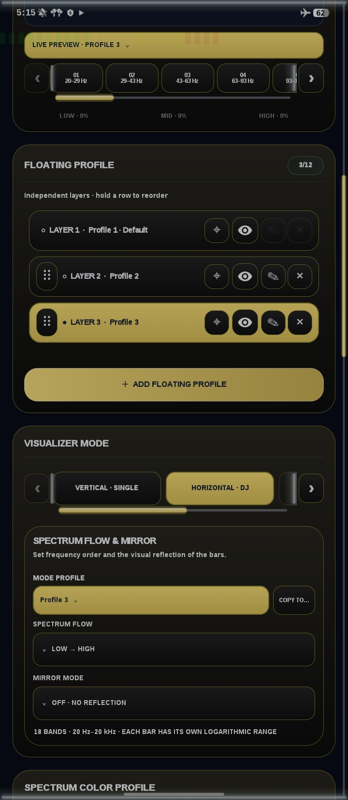

# Floating DJ Visualizer

### Android Floating Audio Visualizer &amp; Experimental Equalizer

**Developed by Rifki**

  
  
  
  

**Visualize your sound. Customize every layer.**

  <strong>&#127468;&#127463; EN</strong> - A customizable, audio-reactive floating visualizer with independent layers, reusable scenes, Theme Studio, and an experimental device-dependent Equalizer Engine.
   
  <strong>&#127470;&#127465; ID</strong> - Floating visualizer responsif yang dapat dikustomisasi dengan layer independen, scene yang dapat digunakan kembali, Theme Studio, dan Equalizer Engine eksperimental yang bergantung pada perangkat.

  <a href="#app-preview">Preview</a> &middot;
  <a href="#key-features">Features</a> &middot;
  <a href="#audio-processing-notes">Audio Notes</a> &middot;
  <a href="#compatibility">Compatibility</a> &middot;
  <a href="#changelog">Changelog</a> &middot;
  <a href="#contact">Contact</a>

---

## Contents | Daftar Isi

- [App Preview | Pratinjau Aplikasi](#app-preview)
- [About | Tentang Proyek](#about)
- [Key Features | Fitur Utama](#key-features)
- [Test Presets | Preset Uji Coba](#test-presets)
- [Technology Stack | Teknologi](#technology-stack)
- [Compatibility | Kompatibilitas](#compatibility)
- [Audio Processing Notes | Catatan Audio](#audio-processing-notes)
- [Development History & Changelog](#changelog)
- [Contact | Kontak](#contact)

---

## App Preview

*Pratinjau Aplikasi*

<strong>&#127468;&#127463; Open screenshot gallery / &#127470;&#127465; Buka galeri (6 images)</strong>

Tap a thumbnail to view the full-size image. / Ketuk thumbnail untuk melihat gambar ukuran penuh.

<!-- Row 1: each row is a separate one-row table so GitHub does not zebra-stripe the gallery cards. -->
<table align="center">
  <tr>
    <td align="center" width="33%">
      
       <strong>01 · Main Dashboard</strong>
       Halaman Utama
       EN: App overview and main controls. ID: Ringkasan aplikasi dan kontrol utama.
    </td>
    <td align="center" width="33%">
      
       <strong>02 · Floating Profiles</strong>
       Profile dan Layer
       EN: Manage independent visualizer profiles and layers. ID: Kelola profile dan layer visualizer secara terpisah.
    </td>
    <td align="center" width="33%">
      
       <strong>03 · Bar Palette Studio</strong>
       Studio Palet Warna Bar
       EN: Customize colors and preview palette choices. ID: Atur warna dan lihat pratinjau pilihan palet.
    </td>
  </tr>
</table>

 

<!-- Row 2 uses the same one-row table structure and alignment as row 1. -->
<table align="center">
  <tr>
    <td align="center" width="33%">
      
       <strong>04 · Equalizer Bands</strong>
       Band Equalizer
       EN: Explore the frequency-band controls. ID: Jelajahi kontrol setiap pita frekuensi.
    </td>
    <td align="center" width="33%">
      
       <strong>05 · Equalizer Components</strong>
       Komponen Equalizer dan Efek Audio
       EN: Review available EQ and audio-effect controls. ID: Lihat kontrol EQ dan efek audio yang tersedia.
    </td>
    <td align="center" width="33%">
      
       <strong>06 · 100 Bar Color Palettes</strong>
       Galeri 100 Palet Warna Bar
       EN: Browse the built-in collection of color palettes. ID: Jelajahi koleksi palet warna bawaan.
    </td>
  </tr>
</table>

  &#127468;&#127463; More screenshots are available in <a href="dokumentasi/">dokumentasi/</a>. / &#127470;&#127465; Tangkapan layar lainnya tersedia di folder <a href="dokumentasi/">dokumentasi/</a>.

---

## About | Tentang Proyek

**&#127468;&#127463; English**

Floating DJ Visualizer is an Android application developed by **Rifki**. It began as a floating audio visualizer and has evolved into a layered visual workspace for real-time audio-reactive displays. The application includes independent floating profiles, per-layer controls, reusable scenes, detailed appearance settings, and an additional experimental Equalizer Engine.

The project is developed directly on an Android device using the open-source [CodeAssist IDE](https://github.com/tyron12233/CodeAssist).

**&#127470;&#127465; Bahasa Indonesia**

Floating DJ Visualizer adalah aplikasi Android yang dikembangkan oleh **Rifki**. Berawal dari floating audio visualizer, proyek ini berkembang menjadi workspace visual berlapis yang merespons audio secara real-time. Aplikasi menyediakan floating profile independen, kontrol setiap layer, scene yang dapat digunakan kembali, pengaturan tampilan mendalam, serta Equalizer Engine tambahan yang masih bersifat eksperimental.

Proyek ini dikembangkan langsung melalui perangkat Android menggunakan [CodeAssist IDE](https://github.com/tyron12233/CodeAssist) yang bersifat open-source.

> **Project status / Status proyek:** V3.0.19.0 is the current documented development line. The Equalizer Engine is experimental and device-dependent. / V3.0.19.0 adalah lini pengembangan yang didokumentasikan saat ini. Equalizer Engine masih eksperimental dan bergantung pada perangkat.

---

## Key Features | Fitur Utama

### 1. Audio Visualization | Visualisasi Audio

| Feature | &#127468;&#127463; English | &#127470;&#127465; Bahasa Indonesia |
|---|---|---|
| **Floating Overlay** | Displays the visualizer above other apps after overlay permission is granted. | Menampilkan visualizer di atas aplikasi lain setelah izin overlay diberikan. |
| **Visualizer Modes** | Supports Single and Horizontal / DJ layouts. | Mendukung layout Single dan Horizontal / DJ. |
| **Bar Controls** | Adjust bar count, width, height, thickness, gap, scale, opacity, glow, and corner shape where supported. | Mengatur jumlah bar, lebar, tinggi, ketebalan, jarak, skala, opacity, glow, dan bentuk sudut sesuai mode. |
| **Frequency Display** | Shows frequency ranges and activity levels for the selected mode. | Menampilkan rentang frekuensi dan level aktivitas sesuai mode yang dipilih. |
| **Appearance Styles** | Clean, Glossy, Neon, and Frosted styles with editable color profiles. | Gaya Clean, Glossy, Neon, dan Frosted dengan profil warna yang dapat diedit. |
| **Position Studio** | Controls the position, movement, and rotation of each floating layer. | Mengatur posisi, pergerakan, dan rotasi setiap floating layer. |

### 2. Visual Studio &amp; Workflow | Studio Visual &amp; Alur Kerja

| Feature | &#127468;&#127463; English | &#127470;&#127465; Bahasa Indonesia |
|---|---|---|
| **Theme Studio** | Glossy, Custom, System, Dark, and Light interface themes. | Tema antarmuka Glossy, Custom, System, Dark, dan Light. |
| **Floating Profiles &amp; Layers** | Manage multiple independent layers and change their order. | Mengelola beberapa layer independen dan mengubah urutannya. |
| **Per-Slider Linking** | Link one supported parameter to multiple compatible layers, with mode-aware target selection. | Menghubungkan satu parameter ke beberapa layer yang kompatibel dengan pemeriksaan mode. |
| **Copy To** | Copy supported profile or appearance settings to another layer. | Menyalin pengaturan profile atau tampilan yang didukung ke layer lain. |
| **Scene Manager** | Save, load, update, rename, delete, import, and export floating scenes. | Menyimpan, memuat, memperbarui, mengganti nama, menghapus, mengimpor, dan mengekspor scene. |
| **Live Numeric Preview** | Preview slider and numeric changes, then commit or cancel them. | Melihat pratinjau perubahan slider dan angka, lalu menyimpan atau membatalkannya. |
| **General Import / Export** | Back up supported settings, profiles, scenes, and EQ data with validation and import review. Runtime permissions and active engines are not transferred or auto-started. | Mencadangkan pengaturan, profile, scene, dan data EQ yang didukung melalui validasi dan tinjauan impor. Izin runtime serta engine aktif tidak dipindahkan atau dijalankan otomatis. |
| **Notification Controls** | Theme-aware controls for supported visualizer and EQ actions. | Kontrol notifikasi yang mengikuti tema untuk fungsi visualizer dan EQ yang didukung. |

### 3. Experimental Equalizer Engine | Equalizer Eksperimental

| Feature | &#127468;&#127463; English | &#127470;&#127465; Bahasa Indonesia |
|---|---|---|
| **Adaptive EQ Bands** | Shows supported band layouts detected by the active backend, including 5-band or 10-band configurations where available. | Menampilkan susunan band yang terdeteksi pada backend aktif, termasuk konfigurasi 5-band atau 10-band jika tersedia. |
| **Band Analyzer &amp; Presets** | Reports detected band capabilities and filters built-in presets to matching band counts. | Menampilkan kemampuan band yang terdeteksi dan menyaring preset bawaan berdasarkan jumlah band yang sesuai. |
| **Band Editing** | Vertical faders, direct dB input, and individual band reset. | Fader vertikal, input dB langsung, dan reset setiap band. |
| **Additional Effects** | Bass Boost, Virtualizer, and Limiter controls where supported by the device and backend. | Kontrol Bass Boost, Virtualizer, dan Limiter sesuai dukungan perangkat dan backend. |
| **EQ Preset Import / Export** | Import and export supported EQ preset files. | Mengimpor dan mengekspor file preset EQ yang didukung. |

---

## Test Presets | Preset Uji Coba

**&#127468;&#127463; English**

Example configurations from development and testing may be available in [`Test - Preset/`](Test%20-%20Preset/). Use files compatible with your application version and review their contents before applying them.

**&#127470;&#127465; Bahasa Indonesia**

Contoh konfigurasi dari proses pengembangan dan pengujian dapat tersedia di folder [`Test - Preset/`](Test%20-%20Preset/). Gunakan file yang sesuai dengan versi aplikasi dan periksa isinya sebelum diterapkan.

---

## Technology Stack | Teknologi

| Component | Technology |
|---|---|
| Platform | Android |
| Main language | Kotlin |
| Development IDE | [CodeAssist](https://github.com/tyron12233/CodeAssist) |
| UI framework | Android Views |
| Audio visualization | Android `Visualizer` API and optional MediaProjection PCM analysis |
| Equalizer | Android audio effects and `DynamicsProcessing` where supported |
| Build tools | Gradle and Android Build Tools |

---

## Compatibility | Kompatibilitas

| Item | Configuration |
|---|---|
| Minimum Android | Android 8.0 (API 26) |
| Target SDK | API 36 |
| Device | Android phones and compatible devices |
| Floating Overlay | Requires the user's Android "Display over other apps" permission. / Memerlukan izin Android "Tampilkan di atas aplikasi lain". |
| Audio effects | Availability and control vary by device, ROM, player, and active audio route. / Ketersediaan dan kontrol bergantung pada perangkat, ROM, player, dan jalur audio aktif. |

---

## Audio Processing Notes | Catatan Pemrosesan Audio

**&#127468;&#127463; English**

The Equalizer Engine is experimental and device-dependent. The current Android output-mix route is not a universal per-player or system-wide mixer. Effect availability, band count, and control behavior may vary by Android version, manufacturer implementation, and active audio route. Detecting an effect does not guarantee that every application or audio route is processed. Some effects require a compatible player-owned audio session.

**&#127470;&#127465; Bahasa Indonesia**

Equalizer Engine masih eksperimental dan bergantung pada perangkat. Jalur output-mix Android saat ini bukan mixer universal per-player atau mixer seluruh sistem. Ketersediaan efek, jumlah band, dan perilaku kontrol dapat berbeda menurut versi Android, implementasi produsen, serta jalur audio aktif. Efek yang terdeteksi tidak menjamin seluruh aplikasi atau jalur audio ikut diproses. Beberapa efek memerlukan audio session milik player yang kompatibel.

---

## Development History & Changelog | Riwayat Pengembangan

This history is arranged from the newest development line to the project's earlier milestones. The overview below gives readers a quick, readable timeline; the expandable notes underneath provide additional implementation context.

Riwayat ini disusun dari lini pengembangan terbaru menuju milestone proyek sebelumnya. Ringkasan di bawah memudahkan pembaca melihat perjalanan versi, sedangkan bagian yang dapat dibuka di bawahnya berisi konteks implementasi lebih lengkap.

  
  

---

### Latest Development Line | V3.0.10–V3.0.19.0

**The current Version 3 development line** — from output-safety refinements to the latest Equalizer, Display, scrolling, interface, and real-time audio-response improvements.

**Lini pengembangan Versi 3 saat ini** — dari penyempurnaan keamanan output hingga pembaruan Equalizer, Display, scrolling, antarmuka, dan respons audio real-time terbaru.

- **V3.0.19.0 — Real-Time PCM Catch-Up & Faster Response:** Prevented stale MediaProjection PCM backlog from keeping the visualizer behind live playback, introduced a faster time-based attack/release response curve shared by Live Display and Floating layers, preserved the existing low/mid/high frequency-analysis paths, and added PCM worker diagnostics.
- **V3.0.18.9 — Main Header Light Sweep & Theme Studio Sparkle:** Added a diagonal light sweep and restrained sparkle particles over the main-page title, with Theme Studio-aware colors and lifecycle-controlled animation.
- **V3.0.18 — Display Geometry & EQ Polish:** Expanded EQ presets and refined Band Analyzer filtering, Live Display geometry, scroll rails, first-open rail visibility, theme-aware toasts, spacing, and animations.
- **V3.0.17 — Import & Workflow Validation:** Improved backup/import validation, runtime-permission review, scene status, layer-position controls, and mode-safe parameter linking.
- **V3.0.16 — Multi-Layer Linking:** Added per-slider linking across compatible layers, global FFT/Hop explanations, and more consistent theme-aware notification controls.
- **V3.0.15 — Numeric Preview & Scene Workflow:** Added reversible live numeric previews, improved Theme Studio repaint behavior and numeric dialogs, and introduced Scene Save To.
- **V3.0.14 — FFT & Notification Refinements:** Refined FFT responsiveness, frequency-range selection, diagnostics, Theme Studio color handling, and notification cold-start restoration.
- **V3.0.13 — Theme-Aware Controls:** Added visible Play/Pause indicators to theme-aware switches and refined EQ preset dropdown animation.
- **V3.0.12 — EQ Controls & Effect Grouping:** Reorganized EQ effect groups, clarified restricted Preamp/Reverb behavior, and polished themed controls and screen motion.
- **V3.0.11 — EQ UI & Profile Scrolling:** Refined EQ effect controls, added Floating Profile drag auto-scroll and glass scroll feedback, and improved Display Live fitting.
- **V3.0.10 — Output Safety:** Added fail-closed output-safety handling for the experimental EQ output-mix Preamp route and refined effect switches and profile scrolling.

---

### V2.4.32 — Final Release of Version 2

V2.4.32 was the final documented V2 milestone before the project moved into the Version 3 Equalizer Engine development line.

V2.4.32 merupakan milestone V2 terakhir yang terdokumentasi sebelum proyek beralih ke lini pengembangan Equalizer Engine Versi 3.

- **Live Engine Restored:** Restored the V2.4.30 Display/Choreographer preview scheduling and live interpolation; removed the V2.4.31 changes associated with frozen previews.
- **Display Glow Optimization:** Reduced the in-app Display preview glow while keeping the Floating renderer's full glow treatment intact.
- **Renderer Integrity:** Preserved FFT delivery, 20 Hz–20 kHz mapping, frame-synchronized animation, Single/Horizontal geometry, and overlay position/rotation behavior.
- **Simultaneous Rendering:** Kept Display preview and Floating rendering active together without scroll-triggered pauses or an imposed Display frame cap.
- **Live Hz Tracking:** Made the Live Hz indicators follow the configured total bar count.
- **100-Color Palette Album:** Added 100 color presets with live preview and Apply/Cancel behavior.
- **Floating Profile Expansion:** Redesigned the profile interface to support up to 12 floating overlay profiles.
- **General UI Refinement:** Polished the V2 interface and workflow. The documented package used versionCode 61.

---

### V1.x — Original Visualizer Foundation

V1.x established the original floating audio visualizer foundation. For the historical V1 feature details and surviving development records, please review the repository's commit history and the historical README revision.

V1.x menjadi fondasi awal floating audio visualizer. Untuk rincian fitur V1 dan arsip pengembangan yang masih tersedia, silakan lihat riwayat commit repository serta revisi README historis.

- [Browse the complete GitHub commit history](https://github.com/rifkiwork74/Projects-Floating-DJ-Visualizer-By-Rifki/commits/main)
- [View the historical V1 README commit](https://github.com/rifkiwork74/Projects-Floating-DJ-Visualizer-By-Rifki/commit/4aa7b510cac972d0fe655698b98a61957ab53311)
- [Browse published GitHub Releases](https://github.com/rifkiwork74/Projects-Floating-DJ-Visualizer-By-Rifki/releases)

Note: A root-level `CHANGELOG.md` is not currently present in the repository. The links above therefore point directly to the available GitHub commit and release records rather than to a file path that would return a missing page.

---

### Detailed Implementation Notes | Rincian Implementasi

The summaries above are intentionally compact. Open a milestone below to read its expanded notes.

Ringkasan di atas sengaja dibuat singkat. Buka milestone di bawah untuk membaca rincian implementasi yang lebih lengkap.

<strong>V3.0.19.0</strong> — Real-Time PCM catch-up, faster response, and audio diagnostics

**EN**
- Update the MediaProjection PCM worker to drain already-buffered complete Hop blocks into the rolling 4096-sample window before running the next FFT. This preserves PCM sample order and the rolling history while publishing only the newest complete window when intermediate FFT windows have become stale.
- Bound the additional catch-up drain to 64 Hops per pass to avoid an unbounded drain loop. When no backlog exists, analysis continues at the configured Hop cadence.
- Replace the legacy 20 Hz-derived smoothing curve with direct time constants evaluated using actual frame delta time. At Response 41%, the approximate attack and release time constants are 16.6 ms and 38.9 ms.
- Use the same response equation in MainActivity Live Display and FloatingVisualizerService layer rendering to keep their response behavior aligned across display refresh rates.
- Preserve FFT 4096, Hop 256, stereo L/R transforms, RMS magnitude combination, the dedicated 256-band Single/DJ frequency bank, the Horizontal 64-band log map, selected frequency ranges, and existing fixed per-route calibration.
- Do not add frame-peak, content-dependent, or whole-spectrum gain normalization.
- Add periodic `FloatingDJ.Audio` / `PCM live` diagnostics containing `batchHops`, configured Hop interval, publish interval, current/average analysis time, and whether the catch-up drain limit was reached.
- Keep the technical limit explicit: Hop 256 at 44.1 kHz is a 5.80 ms analysis step, not a guaranteed 5.80 ms screen-to-screen latency. FFT 4096 remains a 92.9 ms analysis window with approximately 10.77 Hz/bin spacing at 44.1 kHz.
- Preserve `versionName 3.0.19.0` and `versionCode 105`.

**ID**
- Memperbarui worker PCM MediaProjection agar membaca blok Hop lengkap yang sudah tersedia di buffer dan memasukkannya ke rolling window 4096 sampel sebelum menjalankan FFT berikutnya. Urutan sampel PCM dan riwayat rolling window tetap dipertahankan; ketika jendela FFT perantara sudah tertinggal, hanya jendela terbaru yang dianalisis dan dipublikasikan.
- Membatasi proses catch-up tambahan hingga 64 Hop per putaran agar proses drain tidak berjalan tanpa batas. Ketika tidak ada antrean, analisis tetap berjalan mengikuti cadence Hop yang dikonfigurasi.
- Mengganti kurva smoothing lama yang diturunkan dari referensi 20 Hz dengan time constant langsung yang dihitung menggunakan delta waktu frame aktual. Pada Response 41%, perkiraan time constant attack dan release masing-masing adalah 16,6 ms dan 38,9 ms.
- Menggunakan persamaan respons yang sama pada Live Display MainActivity dan rendering layer FloatingVisualizerService agar perilaku keduanya selaras pada berbagai refresh rate layar.
- Mempertahankan FFT 4096, Hop 256, transformasi stereo L/R, kombinasi magnitudo RMS, frequency bank Single/DJ khusus 256-band, peta log Horizontal 64-band, rentang frekuensi pilihan, serta kalibrasi tetap per jalur yang sudah ada.
- Tidak menambahkan normalisasi gain berbasis frame-peak, content-dependent, atau whole-spectrum.
- Menambahkan diagnostik berkala `FloatingDJ.Audio` / `PCM live` yang memuat `batchHops`, interval Hop yang dikonfigurasi, interval publikasi, waktu analisis saat ini/rata-rata, dan informasi apakah batas drain catch-up tercapai.
- Memperjelas batas teknis: Hop 256 pada 44,1 kHz merupakan langkah analisis 5,80 ms, bukan jaminan latency visual layar-ke-layar sebesar 5,80 ms. FFT 4096 tetap menggunakan jendela analisis 92,9 ms dengan jarak sekitar 10,77 Hz/bin pada 44,1 kHz.
- Mempertahankan `versionName 3.0.19.0` dan `versionCode 105`.

<strong>V3.0.18</strong> — Display geometry, scroll rails, EQ presets, and UI polish

**EN**
- Expanded the built-in EQ preset library for detected 5-band and 10-band layouts.
- Refined Band Analyzer filtering and Live Display geometry.
- Improved first-open Equalizer rail visibility and right-side scroll gutters.
- Refined theme-aware toast messages, interface spacing, and animations.
- Preserved versionName 3.0.18 and versionCode 95.

**ID**
- Memperluas pustaka preset EQ untuk susunan 5-band dan 10-band yang terdeteksi.
- Merapikan penyaringan Band Analyzer dan geometri Live Display.
- Memperbaiki visibilitas rail Equalizer saat pertama dibuka dan gutter scrolling sisi kanan.
- Merapikan toast sesuai tema, jarak antarmuka, dan animasi.
- Mempertahankan versionName 3.0.18 dan versionCode 95.

<strong>V3.0.17</strong> — Import validation and workflow refinements

**EN**
- Improved general backup/import validation and runtime-permission review.
- Refined scene status, layer-position controls, and mode-safe parameter linking.
- Improved the Equalizer page scroll indicator.

**ID**
- Memperkuat validasi backup/impor umum dan pemeriksaan izin runtime.
- Merapikan status scene, kontrol posisi layer, dan Linked parameter yang sesuai mode.
- Meningkatkan indikator scrolling halaman Equalizer.

<strong>V3.0.16</strong> — Multi-layer linking and notification consistency

**EN**
- Introduced per-slider linking to multiple compatible layers.
- Added global FFT/Hop explanations.
- Synchronized Start/Stop notification controls and theme-aware contrast.

**ID**
- Memperkenalkan Linked per-slider ke beberapa layer kompatibel.
- Menambahkan penjelasan FFT/Hop global.
- Menyinkronkan kontrol Start/Stop notifikasi dan kontras sesuai tema.

<strong>V3.0.15</strong> — Reversible numeric preview and scene workflow

**EN**
- Added reversible live numeric previews.
- Corrected Theme Studio repaint behavior.
- Refined numeric dialogs and bar-appearance contrast.
- Added Scene Save To.

**ID**
- Menambahkan preview angka real-time yang dapat dibatalkan.
- Memperbaiki repaint Theme Studio.
- Merapikan dialog numerik dan kontras tampilan bar.
- Menambahkan Scene Save To.

<strong>V3.0.14</strong> — FFT responsiveness and notification restoration

**EN**
- Refined FFT decoding and responsiveness, frequency-range selection, and diagnostics.
- Improved Theme Studio color handling and numeric effect dialogs.
- Refined notification cold-start restoration.

**ID**
- Merapikan decoding FFT dan responsivitas, pemilihan rentang frekuensi, serta diagnostik.
- Meningkatkan pengelolaan warna Theme Studio dan dialog angka efek.
- Merapikan pemulihan notifikasi saat cold-start.

<strong>V3.0.13</strong> — Theme-aware switches and preset animation

**EN**
- Added visible Play/Pause glyphs to theme-aware switches.
- Refined EQ preset dropdown reveal and row animation.

**ID**
- Menambahkan ikon Play/Pause pada switch yang mengikuti tema.
- Merapikan animasi dropdown dan baris preset EQ.

<strong>V3.0.12</strong> — EQ effect grouping and interaction polish

**EN**
- Reorganized EQ effect groups.
- Clarified restricted Preamp/Reverb behavior.
- Refined theme-aware controls and screen motion.

**ID**
- Menata ulang kelompok efek EQ.
- Memperjelas batasan Preamp/Reverb.
- Merapikan kontrol bertema dan animasi layar.

<strong>V3.0.11</strong> — EQ controls, profile auto-scroll, and Display fitting

**EN**
- Refined EQ effect controls.
- Added Floating Profile drag auto-scroll and glass scroll feedback.
- Improved Display Live fitting.

**ID**
- Merapikan kontrol efek EQ.
- Menambahkan auto-scroll saat Floating Profile digeser dan indikator scroll glass.
- Meningkatkan penyesuaian Display Live.

<strong>V3.0.10</strong> — Output safety and control refinements

**EN**
- Added fail-closed output safety for the experimental EQ output-mix Preamp route.
- Refined effect switches and profile scrolling while retaining saved values safely.

**ID**
- Menambahkan perlindungan output fail-closed pada jalur Preamp output-mix EQ eksperimental.
- Merapikan switch efek dan scrolling profile dengan tetap mempertahankan nilai tersimpan secara aman.

<strong>V2.4.32</strong> — Final V2 implementation notes

**EN**
- Restored the complete V2.4.30 Display/Choreographer preview scheduling and live interpolation.
- Removed V2.4.31 preview pausing, 30 FPS pacing, and parent-only invalidation changes associated with frozen Display previews.
- Reduced only the in-app Display preview glow using a smaller, lower-intensity halo treatment.
- Preserved the full Floating Service glow renderer, FFT delivery, 20 Hz–20 kHz mapping, frame-synchronized animation, Single/Horizontal geometry, and overlay position/rotation logic.
- Kept Display and Floating renderers running simultaneously without scroll-triggered pauses or Display frame caps.
- Updated Live Hz tracking to follow the configured total bar count.
- Added a 100-preset color album with live preview and Apply/Cancel.
- Redesigned Floating Profile UI to support up to 12 floating overlays.
- Refined general UI/UX; documented versionCode: 61.

**ID**
- Mengembalikan penjadwalan preview Display/Choreographer dan interpolasi real-time V2.4.30 secara penuh.
- Menghapus perubahan preview pause, pacing 30 FPS, dan invalidation parent-only dari V2.4.31 yang berkaitan dengan preview Display macet.
- Mengurangi glow hanya pada preview Display di dalam aplikasi menggunakan halo yang lebih kecil dan lebih ringan.
- Mempertahankan Floating Service glow renderer, pengiriman FFT, pemetaan 20 Hz–20 kHz, animasi sinkron-bingkai, geometri Single/Horizontal, serta logika posisi/rotasi overlay.
- Menjaga renderer Display dan Floating berjalan bersamaan tanpa jeda akibat scrolling atau pembatasan frame Display.
- Memperbarui Live Hz tracking agar mengikuti jumlah total bar yang dikonfigurasi.
- Menambahkan album warna berisi 100 preset dengan live preview serta Apply/Cancel.
- Mendesain ulang Floating Profile UI agar mendukung hingga 12 floating overlay.
- Merapikan UI/UX secara umum; versionCode terdokumentasi: 61.

<strong>V3.0.0–V3.0.9</strong> — Experimental Equalizer Engine milestone

**EN**
- **Integrated Equalizer Engine:** Added an experimental EQ Output Mix engine alongside the existing visualizer system.
- **Adaptive EQ Bands:** Added 5-band and 10-band layouts according to the active backend and device capabilities.
- **Device Capability Detection:** Added effect inventory and runtime capability checks rather than assuming every device supports the same effects.
- **Preset Management:** Added custom preset creation, Save, Save To, Rename, Delete, Current State handling, and Flat reset.
- **Starter EQ Presets:** Added starter curves for 5-band and 10-band configurations.
- **Precision Band Controls:** Added direct dB value input, individual band reset, and horizontal navigation for multi-band layouts.
- **Preamp:** Added input-gain control before EQ processing when supported by the active processing engine.
- **Bass Boost and Virtualizer:** Integrated additional audio-effect controls where device support and control ownership allow.
- **Dynamics Processing Limiter:** Added an experimental limiter stage with configurable enable/disable behavior on supported engines.
- **Reverb Capability Detection:** Added Reverb detection and attachment requirement information. Global Reverb is not assumed.
- **EQ Preset Import/Export:** Added dedicated EQ preset exchange.
- **Modern EQ Workspace:** Added a dedicated Equalizer Activity with Theme Studio integration, modern faders, responsive band canvas, and improved preset controls.
- **Notification Integration:** Expanded notification actions for supported Floating and EQ controls.
- **State and Lifecycle Refinements:** Improved working-state handling and EQ configuration restoration.

**ID**
- **Equalizer Engine Terintegrasi:** Menambahkan EQ Output Mix eksperimental di samping sistem visualizer yang sudah ada.
- **Band EQ Adaptif:** Menghadirkan susunan 5-band dan 10-band sesuai backend aktif dan kemampuan perangkat.
- **Deteksi Kapabilitas Perangkat:** Menambahkan pemeriksaan inventory effect dan kapabilitas runtime, bukan menganggap semua perangkat memiliki dukungan yang sama.
- **Pengelolaan Preset:** Menambahkan pembuatan preset, Save, Save To, Rename, Delete, pengelolaan Current State, dan reset Flat.
- **Preset EQ Awal:** Menambahkan kurva awal untuk konfigurasi 5-band dan 10-band.
- **Kontrol Band Presisi:** Menambahkan input nilai dB langsung, reset setiap band, dan navigasi horizontal untuk layout multi-band.
- **Preamp:** Menambahkan kontrol input gain sebelum proses EQ pada engine yang mendukung.
- **Bass Boost dan Virtualizer:** Mengintegrasikan kontrol efek audio tambahan sesuai dukungan perangkat dan kepemilikan kontrol effect.
- **Dynamics Processing Limiter:** Menambahkan stage limiter eksperimental dengan kontrol aktif/nonaktif pada engine yang mendukung.
- **Deteksi Reverb:** Menambahkan deteksi dukungan Reverb dan informasi persyaratan attachment. Reverb global tidak diasumsikan tersedia.
- **Import/Export Preset EQ:** Menambahkan pertukaran preset EQ secara terpisah.
- **Workspace EQ Modern:** Menghadirkan Equalizer Activity khusus dengan integrasi Theme Studio, fader modern, canvas band adaptif, dan pengelolaan preset yang diperbarui.
- **Integrasi Notifikasi:** Menambahkan kontrol notifikasi untuk fungsi Floating dan EQ yang didukung.
- **Penyempurnaan State dan Lifecycle:** Memperbaiki pengelolaan working state dan pemulihan konfigurasi EQ.

<blockquote>
  <strong>Audio limitation / Batasan audio:</strong> The output-mix/session-0 route is experimental and device-dependent. Detecting or constructing an effect does not prove that all third-party applications or every audio route are processed. Reverb requires a compatible player-owned session and auxiliary send path.
   
  Jalur output-mix/session-0 masih eksperimental dan bergantung pada perangkat. Effect yang terdeteksi atau berhasil dibuat tidak membuktikan bahwa seluruh aplikasi pihak ketiga atau semua jalur audio ikut diproses. Reverb memerlukan session milik player yang kompatibel dan jalur auxiliary send.
</blockquote>

Milestone note: the implementation report groups the documented progression across V3.0.0–V3.0.9. A separate V3.0.4 change record was not available in the implementation dossier.

Catatan milestone: laporan implementasi mengelompokkan progres yang terdokumentasi pada V3.0.0–V3.0.9. Catatan perubahan V3.0.4 secara terpisah tidak tersedia dalam dossier implementasi.

---

**Release and commit references / Referensi rilis dan commit**

- [Browse all repository commits](https://github.com/rifkiwork74/Projects-Floating-DJ-Visualizer-By-Rifki/commits/main)
- [Browse GitHub Releases](https://github.com/rifkiwork74/Projects-Floating-DJ-Visualizer-By-Rifki/releases)
- [View the historical V1 README commit](https://github.com/rifkiwork74/Projects-Floating-DJ-Visualizer-By-Rifki/commit/4aa7b510cac972d0fe655698b98a61957ab53311)

Historical accuracy: V1.x and V2.4.32 are presented as documented milestones. Where the surviving records do not identify a precise patch or public release, this README links to repository history instead of inventing a version-specific record.

Akurasi riwayat: V1.x dan V2.4.32 ditampilkan sebagai milestone yang terdokumentasi. Jika arsip yang tersedia tidak menunjukkan patch atau rilis publik secara pasti, README mengarahkan pembaca ke riwayat repository tanpa mengarang catatan versi tertentu.

---

## Contact | Kontak

**&#127468;&#127463; English:** Feedback, bug reports, suggestions, and collaboration inquiries are welcome.

**&#127470;&#127465; Indonesia:** Masukan, laporan bug, saran, dan pertanyaan kolaborasi dipersilakan.

  

  <strong>Made with passion by Rifki</strong> 
  <em>Floating DJ Visualizer - Visualize Your Sound.</em>

