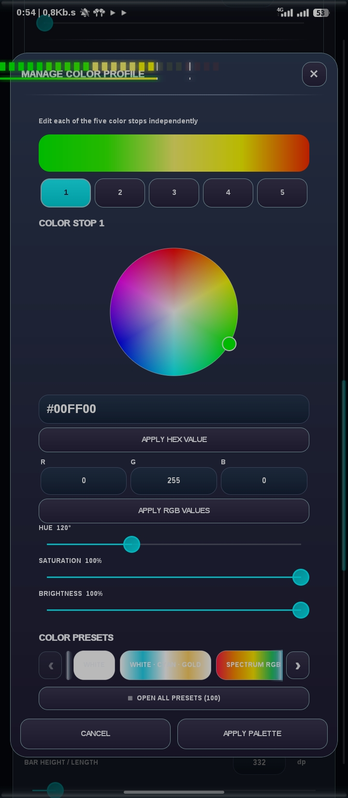
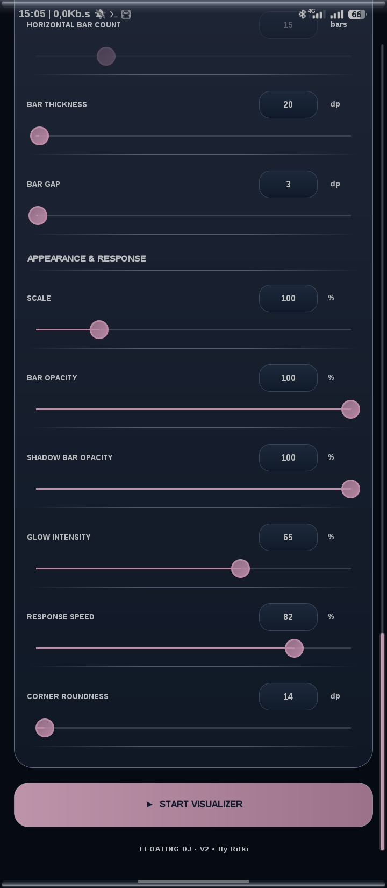

  <h1>
    
    Floating DJ Visualizer
  </h1>

  <h3>Projects Floating DJ Visualizer By Rifki</h3>

  
<i>A customizable floating audio visualizer for Android.</i>

  

    
    
    
    
  

  
<b>Visualisasi audio Android dengan floating overlay, kustomisasi mendalam, dan Equalizer Engine terintegrasi.</b>

  

    <a href="#-preview-aplikasi">Preview</a> ·
    <a href="#-fitur-utama-key-features">Features</a> ·
    <a href="#-changelog">Changelog</a> ·
    <a href="#-contact--collaboration">Contact</a>
  

---

## 📑 Daftar Isi | Table of Contents

- [📸 Preview Aplikasi](#-preview-aplikasi)
- [📖 Tentang Proyek](#-tentang-proyek-about-the-project)
- [✨ Fitur Utama](#-fitur-utama-key-features)
- [🎨 Test Presets](#-preset-uji-coba-test-presets)
- [🛠️ Teknologi](#-teknologi-tech-stack)
- [📱 Kompatibilitas](#-kompatibilitas-compatibility)
- [📝 Changelog](#-changelog)
- [📬 Contact & Collaboration](#-contact--collaboration)

---

## 📸 Preview Aplikasi

<table align="center">
  <tr>
    <td align="center"></td>
    <td align="center"></td>
    <td align="center"></td>
  </tr>
  <tr>
    <td align="center"></td>
    <td align="center"></td>
    <td align="center"></td>
  </tr>
</table>

<i>Lihat koleksi lengkap tangkapan layar lainnya di folder <a href="dokumentasi/">dokumentasi/</a>.</i>

---

## 📖 Tentang Proyek | About the Project

**Floating DJ Visualizer** is an Android application developed by **Rifki**. It combines a customizable floating audio visualizer, real-time visual controls, profile and scene management, and an additional experimental Equalizer Engine.

The project began as a floating audio visualizer and continued to grow through multiple development milestones. With **v3.0.9**, Floating DJ Visualizer enters a new chapter by introducing integrated audio equalization and additional audio-effect controls alongside its established visualization features.

**Floating DJ Visualizer** adalah aplikasi Android yang dikembangkan oleh **Rifki**. Aplikasi ini menggabungkan floating audio visualizer yang dapat dikustomisasi, kontrol visual real-time, pengelolaan profile dan scene, serta tambahan Equalizer Engine eksperimental.

Pada **v3.0.9**, proyek memasuki tahap baru dengan menghadirkan equalizer audio terintegrasi dan beberapa kontrol efek audio tambahan, tanpa meninggalkan sistem visualizer yang telah dikembangkan sebelumnya.

> **Built directly from an Android smartphone.** Seluruh proses pengembangan dilakukan langsung melalui smartphone Android menggunakan IDE open-source **[CodeAssist](https://github.com/tyron12233/CodeAssist)**.

---

## ✨ Fitur Utama | Key Features

### 🎵 Audio Visualization

| Feature | Description |
|---|---|
| **Floating Overlay** | Menampilkan visualizer di atas aplikasi lain dengan posisi yang dapat dipindahkan. |
| **Visualizer Modes** | Mendukung mode Single dan Horizontal / DJ. |
| **Bar Customization** | Mengatur jumlah bar, gap, ketebalan, tinggi, dan tampilan visual. |
| **Live Hz Tracking** | Pelacakan frekuensi yang menyesuaikan konfigurasi bar visualizer. |
| **Glow Effects** | Pengaturan intensitas glow pada gaya visual yang didukung. |
| **Bar Appearance** | Pilihan gaya Clean, Glossy, Neon, dan Frosted. |
| **Position Control** | Mengatur posisi floating overlay secara horizontal maupun vertikal. |

### 🎨 Visual Customization

| Feature | Description |
|---|---|
| **Real-Time Color Studio** | Album warna dengan **100 preset palet** dan live preview. |
| **UI Themes** | Pilihan Glossy, Custom, System, Dark, dan Light. |
| **Floating Profiles & Layers** | Mengelola beberapa konfigurasi floating dan layer secara terpisah. |
| **Scene Manager** | Menyimpan dan mengelola konfigurasi visualizer sebagai scene. |
| **Live Preview** | Melihat perubahan tampilan secara real-time sebelum diterapkan. |
| **Import & Export** | Memindahkan konfigurasi dan preset yang didukung aplikasi. |

### 🎚️ Integrated Equalizer Engine — New in Version 3

  
<b>Experimental Audio Equalizer</b>

  Version 3 adds an experimental Equalizer Engine as an additional audio-control system inside Floating DJ Visualizer.

  Versi 3 menghadirkan Equalizer Engine eksperimental sebagai sistem pengaturan audio tambahan di dalam Floating DJ Visualizer.

  | Feature | Description |
  |---|---|
  | **5-Band / 10-Band EQ** | Kontrol frekuensi berdasarkan band yang tersedia pada audio engine aktif. |
  | **Device Band Detection** | Mendeteksi jumlah band dan frekuensi dari effect yang berhasil digunakan. |
  | **EQ Preset Manager** | Membuat, menyimpan, memilih, mengganti nama, dan menghapus preset EQ. |
  | **Starter Presets** | Pilihan preset awal untuk konfigurasi 5-band dan 10-band. |
  | **Individual Band Reset** | Mengembalikan masing-masing band ke nilai default. |
  | **Direct Band Value Input** | Mengubah nilai gain band melalui input angka. |
  | **Preamp** | Mengatur input gain sebelum EQ pada engine yang mendukung. |
  | **Bass Boost** | Penguatan frekuensi rendah melalui audio effect yang tersedia. |
  | **Virtualizer** | Kontrol efek spasial sesuai dukungan perangkat dan audio route. |
  | **Limiter** | Limiter eksperimental melalui Dynamics Processing pada engine yang mendukung. |
  | **Reverb Detection** | Mendeteksi ketersediaan Reverb dan menampilkan persyaratan attachment. |
  | **EQ Import / Export** | Memindahkan konfigurasi preset EQ melalui format preset aplikasi. |
  | **Notification Controls** | Akses kontrol visualizer dan EQ yang didukung melalui notifikasi. |
  | **Theme-Integrated EQ UI** | Halaman EQ mengikuti sistem tema dan preferensi tampilan aplikasi. |

> **⚠️ Audio Processing Notice**
>
> The Equalizer Engine is experimental. Actual audio processing depends on Android version, device manufacturer, audio-effect implementation, active audio route, and player/session compatibility.
>
> EQ Output Mix must not be interpreted as a guarantee that every application or every audio route is processed. Available bands and effects may vary between devices.
>
> **Catatan:** Equalizer Engine masih bersifat eksperimental. Hasil pemrosesan audio bergantung pada versi Android, implementasi audio perangkat, route yang digunakan, serta kompatibilitas player/session. Deteksi suatu efek tidak otomatis berarti seluruh aplikasi lain ikut diproses.

**Reverb note:** Android Reverb may require a compatible player or audio session to attach the effect and provide an auxiliary send level. Detecting a Reverb implementation does not guarantee system-wide Reverb processing.

**Catatan Reverb:** Reverb Android dapat memerlukan player atau audio session yang kompatibel untuk melakukan attachment dan mengirimkan send level. Reverb yang terdeteksi belum tentu dapat memproses seluruh audio sistem.

---

## 🎨 Preset Uji Coba | Test Presets

Ingin langsung mencoba konfigurasi yang sudah disiapkan?

Kunjungi folder **[`Test - Preset`](Test%20-%20Preset/)** di repositori ini. Folder tersebut berisi preset yang digunakan selama proses pengembangan dan pengujian.

- **Preset General App** — Konfigurasi umum untuk aplikasi.
- **Preset Per Scenes** — Konfigurasi khusus untuk desain bar, warna, dan scene tertentu.

**Cara penggunaan:**

1. Unduh file preset dari folder repositori.
2. Buka Floating DJ Visualizer.
3. Gunakan fitur Import yang sesuai.
4. Pilih file preset.
5. Sesuaikan kembali konfigurasi jika diperlukan.

> Kompatibilitas preset dapat bergantung pada versi aplikasi dan fitur yang tersedia di perangkat.

---

## 🛠️ Teknologi | Tech Stack

| Component | Technology |
|---|---|
| **Platform** | Android |
| **Development Tool** | [CodeAssist — On-Device Mobile IDE](https://github.com/tyron12233/CodeAssist) |
| **Main Language** | Kotlin |
| **UI Framework** | Android Views |
| **Audio Visualization** | Android `Visualizer` API and supported FFT processing |
| **Equalizer Engine** | Android audio effects and `DynamicsProcessing` where supported |
| **Additional Audio Effects** | Bass Boost, Virtualizer, Limiter, and Reverb where supported |
| **Build System** | Gradle / Android Build Tools |

---

## 📱 Kompatibilitas | Compatibility

| Item | Configuration |
|---|---|
| **Minimum SDK** | API 26 |
| **Target SDK** | API 36 |
| **Platform** | Android smartphones and compatible devices |
| **Audio Support** | Depends on device audio implementation and active route |

- Aplikasi dirancang untuk perangkat Android.
- Dukungan FFT, Equalizer, Bass Boost, Virtualizer, Limiter, dan Reverb dapat berbeda tergantung perangkat dan implementasi vendor.
- Perangkat yang memiliki API audio tertentu belum tentu menyediakan implementasi effect yang dapat dikendalikan aplikasi.
- EQ Output Mix tetap eksperimental dan tidak menjamin pemrosesan global pada semua aplikasi.

---

## 📝 Changelog

### 🚀 V3.0.0 → V3.0.9 — Equalizer Engine Milestone

**A major development milestone:** Floating DJ Visualizer expands from a floating audio visualizer into an application with an additional experimental Equalizer Engine.

**Pencapaian besar:** Floating DJ Visualizer berkembang dari aplikasi floating audio visualizer menjadi aplikasi dengan tambahan Equalizer Engine eksperimental.

#### 🇬🇧 English

- **Integrated Equalizer Engine:** Added an experimental EQ Output Mix engine alongside the existing visualizer system.
- **5-Band and 10-Band Equalizer:** Added adaptive frequency-band controls based on the active audio effect and device capabilities.
- **Device Capability Detection:** Added effect inventory and runtime capability checks rather than assuming every device supports the same effects.
- **Preset Management:** Added custom preset creation, Save, Save To, Rename, Delete, Current State handling, and Flat reset.
- **Starter EQ Presets:** Added starter curves for 5-band and 10-band configurations.
- **Precision Band Controls:** Added direct dB value input, individual band reset, and horizontal navigation for multi-band layouts.
- **Preamp:** Added input-gain control before EQ processing when supported by the active processing engine.
- **Bass Boost and Virtualizer:** Integrated additional audio-effect controls where device support and control ownership allow.
- **Dynamics Processing Limiter:** Added an experimental limiter stage with configurable enable/disable behavior on supported engines.
- **Reverb Capability Detection:** Added Reverb detection and attachment requirement information. Global Reverb is not assumed.
- **EQ Preset Import / Export:** Added dedicated EQ preset exchange.
- **Modern EQ Workspace:** Added a dedicated Equalizer Activity with Theme Studio integration, modern faders, responsive band canvas, and improved preset controls.
- **Notification Integration:** Expanded notification actions for supported Floating and EQ controls.
- **State and Lifecycle Refinements:** Improved working-state handling and EQ configuration restoration.

#### 🇮🇩 Indonesia

- **Equalizer Engine Terintegrasi:** Menambahkan EQ Output Mix eksperimental di samping sistem visualizer yang sudah ada.
- **Equalizer 5-Band dan 10-Band:** Menghadirkan kontrol frekuensi adaptif berdasarkan audio effect aktif dan kemampuan perangkat.
- **Deteksi Kemampuan Perangkat:** Menambahkan pemeriksaan inventory effect dan kapabilitas runtime, sehingga aplikasi tidak menganggap semua perangkat memiliki dukungan yang sama.
- **Pengelolaan Preset:** Menambahkan pembuatan preset, Save, Save To, Rename, Delete, pengelolaan Current State, dan reset Flat.
- **Preset EQ Bawaan:** Menambahkan kurva awal untuk konfigurasi 5-band dan 10-band.
- **Kontrol Band Presisi:** Menambahkan input nilai dB, reset masing-masing band, dan navigasi horizontal untuk layout multi-band.
- **Preamp:** Menambahkan kontrol input gain sebelum proses EQ pada engine yang mendukung.
- **Bass Boost dan Virtualizer:** Mengintegrasikan kontrol efek audio tambahan sesuai dukungan perangkat dan kepemilikan kontrol effect.
- **Dynamics Processing Limiter:** Menambahkan stage limiter eksperimental dengan kontrol aktif/nonaktif pada engine yang mendukung.
- **Deteksi Reverb:** Menambahkan deteksi dukungan Reverb dan informasi persyaratan attachment. Reverb global tidak diasumsikan tersedia.
- **Import / Export Preset EQ:** Menambahkan pertukaran preset EQ secara terpisah.
- **Workspace EQ Modern:** Menghadirkan Equalizer Activity khusus dengan integrasi Theme Studio, fader modern, canvas band adaptif, dan pengelolaan preset yang diperbarui.
- **Integrasi Notifikasi:** Menambahkan kontrol notifikasi untuk fungsi Floating dan EQ yang didukung.
- **Penyempurnaan State dan Lifecycle:** Memperbaiki pengelolaan working state dan pemulihan konfigurasi EQ.

> Ringkasan V3.0.0–V3.0.9 ini menggabungkan milestone pengembangan versi 3. Untuk rincian patch per versi, lihat halaman GitHub Releases jika tersedia.

### 🔹 V2.4.32 — The Final V2 Update
**Engine & UI Overhaul**

#### 🇬🇧 English (EN)

- **Live Engine Restored:** Restored the complete v2.4.30 Display/Choreographer preview scheduling and live interpolation. Removed the v2.4.31 preview pausing, 30 FPS pacing, and parent-only invalidation changes that caused visual freezes.
- **Glow Optimization:** Reduced only the in-app Display preview glow by replacing its three-pass halo with a single smaller, lower-alpha pass, and removed redundant glow passes from live/held peak markers.
- **Renderer Integrity:** Maintained the full Floating Service glow renderer, FFT delivery, 20 Hz–20 kHz mapping, frame-synchronized animation, Single/Horizontal geometry, and overlay position/rotation logic unchanged.
- **Simultaneous Rendering:** Display and Floating renderers now run simultaneously without scroll-triggered pauses or Display frame caps.
- **Live Hz Tracking:** The Live Hz tracking display now dynamically adjusts per bar line, following the total bar count configuration.
- **Real-Time Color Studio:** The UI Preset color album now features **100 color presets**. Tapping a preset instantly applies a live preview to the visualizer. Click `Apply` to keep it or `Cancel` to revert!
- **Profile Expansion:** Redesigned the Floating Profile UI, allowing up to 1/12 Floating Overlays directly on your screen.
- **General Polish:** Refined app UX/UI design for maximum neatness. Bumped version to 2.4.32 / versionCode 61.

#### 🇮🇩 Indonesia (ID)

- **Pemulihan Live Engine:** Mengembalikan penjadwalan Display/Choreographer preview dan interpolasi langsung dari v2.4.30 secara penuh. Menghapus jeda preview, pembatasan 30 FPS, dan masalah invalidation dari v2.4.31 yang menyebabkan tampilan macet.
- **Optimasi Efek Glow:** Mengurangi efek glow hanya pada pratinjau Display di dalam aplikasi: mengganti tiga lapis halo dengan satu lapis alpha rendah, serta menghapus glow berlebih pada penanda puncak.
- **Integritas Renderer:** Mempertahankan Floating Service glow renderer, pengiriman FFT, pemetaan 20 Hz–20 kHz, animasi sinkron-bingkai, geometri Single/Horizontal, serta logika posisi/rotasi overlay.
- **Rendering Simultan:** Renderer Display dan Floating berjalan bersamaan tanpa jeda saat menggulir layar atau pembatasan frame.
- **Live Hz Tracking:** Pelacakan Live Hz otomatis menyesuaikan tampilan pada setiap garis mengikuti jumlah bar yang diatur.
- **Real-Time Color Studio:** Album warna dilengkapi **100 Preset Palet** dengan pratinjau real-time. Klik `Apply` untuk menyimpan atau `Cancel` untuk membatalkan.
- **Ekspansi Profil:** Desain UI Floating Profile diperbarui dan mendukung hingga 12 Floating Overlay.
- **Penyempurnaan Umum:** Desain UI/UX dirapikan. Versi ditingkatkan ke 2.4.32 / versionCode 61.

> Untuk riwayat versi sebelumnya seperti v2.3.3, v2.2.3, dan v1.x, silakan kunjungi halaman Releases repositori.

---

## 📬 Contact & Collaboration

Punya pertanyaan, masukan, ide pengembangan, atau tertarik untuk berkolaborasi?

*Have questions, feedback, suggestions, or want to collaborate?*

  

  <b>Email:</b> <a href="mailto:rifki.work74@outlook.com">rifki.work74@outlook.com</a>

---

  <b>Made with passion by Rifki</b> 🎧
    
  <i>Floating DJ Visualizer — Visualize Your Sound.</i>

