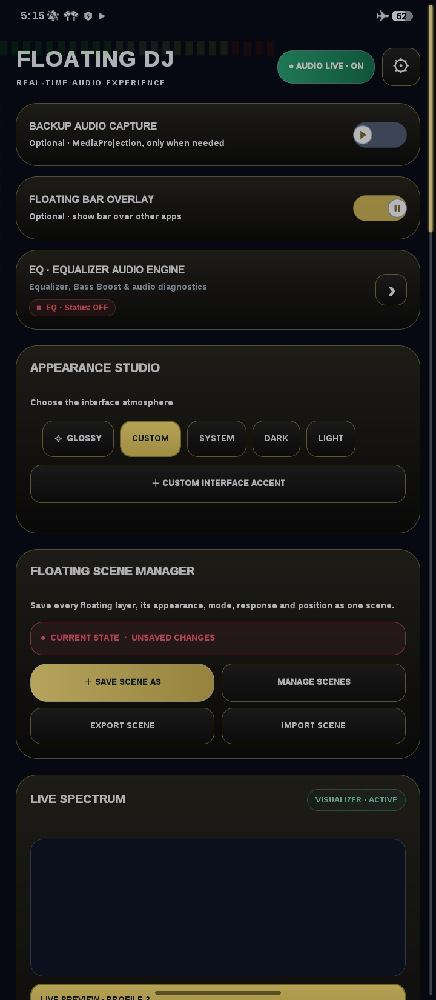
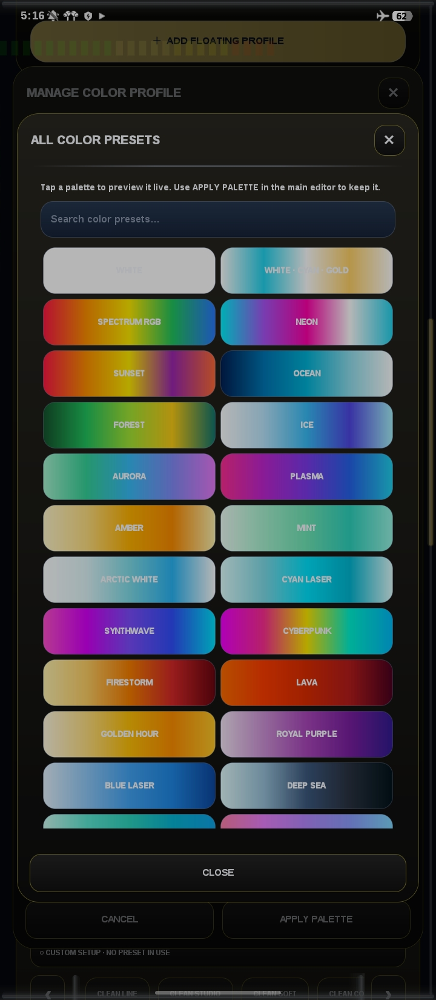

# Floating DJ Visualizer

### Android Floating Audio Visualizer & Experimental Equalizer

**Developed by Rifki**

  
  
  
  

**Visualize your sound. Customize every layer.**

  <strong>&#127468;&#127463; EN</strong> - A customizable, audio-reactive floating visualizer with independent layers, reusable scenes, Theme Studio, and an experimental device-dependent Equalizer Engine.
   
  <strong>&#127470;&#127465; ID</strong> - Floating visualizer responsif yang dapat dikustomisasi dengan layer independen, scene yang dapat digunakan kembali, Theme Studio, dan Equalizer Engine eksperimental yang bergantung pada perangkat.

  <a href="#app-preview">Preview</a> &middot;
  <a href="#key-features">Features</a> &middot;
  <a href="#audio-processing-notes">Audio Notes</a> &middot;
  <a href="#compatibility">Compatibility</a> &middot;
  <a href="#changelog">Changelog</a> &middot;
  <a href="#contact">Contact</a>

---

## Contents | Daftar Isi

- [App Preview | Pratinjau Aplikasi](#app-preview)
- [About | Tentang Proyek](#about)
- [Key Features | Fitur Utama](#key-features)
- [Test Presets | Preset Uji Coba](#test-presets)
- [Technology Stack | Teknologi](#technology-stack)
- [Compatibility | Kompatibilitas](#compatibility)
- [Audio Processing Notes | Catatan Audio](#audio-processing-notes)
- [Changelog V3.0.10-V3.0.18](#changelog)
- [Contact | Kontak](#contact)

---

## App Preview

*Pratinjau Aplikasi*

<strong>&#127468;&#127463; Open screenshot gallery / &#127470;&#127465; Buka galeri (6 images)</strong>

Tap a thumbnail to view the full-size image. / Ketuk thumbnail untuk melihat gambar ukuran penuh.

<table>
  <tr>
    <td align="center" width="33%">
       
      <strong>01 - Main Dashboard</strong> Halaman Utama
    </td>
    <td align="center" width="33%">
       
      <strong>02 - Floating Profiles</strong> Profile dan Layer
    </td>
    <td align="center" width="33%">
       
      <strong>03 - Pallet Studio Bar</strong> Pallet dan Warna
    </td>
  </tr>
  <tr>
    <td align="center" width="33%">
       
      <strong>04 - Equalizer Engine</strong> Pengelola Bands Equalizer
    </td>
    <td align="center" width="33%">
       
      <strong>05 - Component Equalizer Engine</strong> Mesin Bass bosst Equalizer
    </td>
    <td align="center" width="33%">
       
      <strong>06 - Preset Color 100 Pallet Bar</strong> Galery 100 Warna Bar 
    </td>
  </tr>
</table>

  &#127468;&#127463; More screenshots are available in <a href="dokumentasi/">dokumentasi/</a>. / &#127470;&#127465; Tangkapan layar lainnya tersedia di folder <a href="dokumentasi/">dokumentasi/</a>.

---

## About | Tentang Proyek

**&#127468;&#127463; English**

Floating DJ Visualizer is an Android application developed by **Rifki**. It began as a floating audio visualizer and has evolved into a layered visual workspace for real-time audio-reactive displays. The application includes independent floating profiles, per-layer controls, reusable scenes, detailed appearance settings, and an additional experimental Equalizer Engine.

The project is developed directly on an Android device using the open-source [CodeAssist IDE](https://github.com/tyron12233/CodeAssist).

**&#127470;&#127465; Bahasa Indonesia**

Floating DJ Visualizer adalah aplikasi Android yang dikembangkan oleh **Rifki**. Berawal dari floating audio visualizer, proyek ini berkembang menjadi workspace visual berlapis yang merespons audio secara real-time. Aplikasi menyediakan floating profile independen, kontrol setiap layer, scene yang dapat digunakan kembali, pengaturan tampilan mendalam, serta Equalizer Engine tambahan yang masih bersifat eksperimental.

Proyek ini dikembangkan langsung melalui perangkat Android menggunakan [CodeAssist IDE](https://github.com/tyron12233/CodeAssist) yang bersifat open-source.

> **Project status / Status proyek:** V3.0.18 is the current documented development line. The Equalizer Engine is experimental and device-dependent. / V3.0.18 adalah lini pengembangan yang didokumentasikan saat ini. Equalizer Engine masih eksperimental dan bergantung pada perangkat.

---

## Key Features | Fitur Utama

### 1. Audio Visualization | Visualisasi Audio

| Feature | &#127468;&#127463; English | &#127470;&#127465; Bahasa Indonesia |
|---|---|---|
| **Floating Overlay** | Displays the visualizer above other apps after overlay permission is granted. | Menampilkan visualizer di atas aplikasi lain setelah izin overlay diberikan. |
| **Visualizer Modes** | Supports Single and Horizontal / DJ layouts. | Mendukung layout Single dan Horizontal / DJ. |
| **Bar Controls** | Adjust bar count, width, height, thickness, gap, scale, opacity, glow, and corner shape where supported. | Mengatur jumlah bar, lebar, tinggi, ketebalan, jarak, skala, opacity, glow, dan bentuk sudut sesuai mode. |
| **Frequency Display** | Shows frequency ranges and activity levels for the selected mode. | Menampilkan rentang frekuensi dan level aktivitas sesuai mode yang dipilih. |
| **Appearance Styles** | Clean, Glossy, Neon, and Frosted styles with editable color profiles. | Gaya Clean, Glossy, Neon, dan Frosted dengan profil warna yang dapat diedit. |
| **Position Studio** | Controls the position, movement, and rotation of each floating layer. | Mengatur posisi, pergerakan, dan rotasi setiap floating layer. |

### 2. Visual Studio & Workflow | Studio Visual & Alur Kerja

| Feature | &#127468;&#127463; English | &#127470;&#127465; Bahasa Indonesia |
|---|---|---|
| **Theme Studio** | Glossy, Custom, System, Dark, and Light interface themes. | Tema antarmuka Glossy, Custom, System, Dark, dan Light. |
| **Floating Profiles & Layers** | Manage multiple independent layers and change their order. | Mengelola beberapa layer independen dan mengubah urutannya. |
| **Per-Slider Linking** | Link one supported parameter to multiple compatible layers, with mode-aware target selection. | Menghubungkan satu parameter ke beberapa layer yang kompatibel dengan pemeriksaan mode. |
| **Copy To** | Copy supported profile or appearance settings to another layer. | Menyalin pengaturan profile atau tampilan yang didukung ke layer lain. |
| **Scene Manager** | Save, load, update, rename, delete, import, and export floating scenes. | Menyimpan, memuat, memperbarui, mengganti nama, menghapus, mengimpor, dan mengekspor scene. |
| **Live Numeric Preview** | Preview slider and numeric changes, then commit or cancel them. | Melihat pratinjau perubahan slider dan angka, lalu menyimpan atau membatalkannya. |
| **General Import / Export** | Back up supported settings, profiles, scenes, and EQ data with validation and import review. Runtime permissions and active engines are not transferred or auto-started. | Mencadangkan pengaturan, profile, scene, dan data EQ yang didukung melalui validasi dan tinjauan impor. Izin runtime serta engine aktif tidak dipindahkan atau dijalankan otomatis. |
| **Notification Controls** | Theme-aware controls for supported visualizer and EQ actions. | Kontrol notifikasi yang mengikuti tema untuk fungsi visualizer dan EQ yang didukung. |

### 3. Experimental Equalizer Engine | Equalizer Eksperimental

| Feature | &#127468;&#127463; English | &#127470;&#127465; Bahasa Indonesia |
|---|---|---|
| **Adaptive EQ Bands** | Shows supported band layouts detected by the active backend, including 5-band or 10-band configurations where available. | Menampilkan susunan band yang terdeteksi pada backend aktif, termasuk konfigurasi 5-band atau 10-band jika tersedia. |
| **Band Analyzer & Presets** | Reports detected band capabilities and filters built-in presets to matching band counts. | Menampilkan kemampuan band yang terdeteksi dan menyaring preset bawaan berdasarkan jumlah band yang sesuai. |
| **Band Editing** | Vertical faders, direct dB input, and individual band reset. | Fader vertikal, input dB langsung, dan reset setiap band. |
| **Additional Effects** | Bass Boost, Virtualizer, and Limiter controls where supported by the device and backend. | Kontrol Bass Boost, Virtualizer, dan Limiter sesuai dukungan perangkat dan backend. |
| **EQ Preset Import / Export** | Import and export supported EQ preset files. | Mengimpor dan mengekspor file preset EQ yang didukung. |

---

## Test Presets | Preset Uji Coba

**&#127468;&#127463; English**

Example configurations from development and testing may be available in [`Test - Preset/`](Test%20-%20Preset/). Use files compatible with your application version and review their contents before applying them.

**&#127470;&#127465; Bahasa Indonesia**

Contoh konfigurasi dari proses pengembangan dan pengujian dapat tersedia di folder [`Test - Preset/`](Test%20-%20Preset/). Gunakan file yang sesuai dengan versi aplikasi dan periksa isinya sebelum diterapkan.

---

## Technology Stack | Teknologi

| Component | Technology |
|---|---|
| Platform | Android |
| Main language | Kotlin |
| Development IDE | [CodeAssist](https://github.com/tyron12233/CodeAssist) |
| UI framework | Android Views |
| Audio visualization | Android `Visualizer` API and optional MediaProjection PCM analysis |
| Equalizer | Android audio effects and `DynamicsProcessing` where supported |
| Build tools | Gradle and Android Build Tools |

---

## Compatibility | Kompatibilitas

| Item | Configuration |
|---|---|
| Minimum Android | Android 8.0 (API 26) |
| Target SDK | API 36 |
| Device | Android phones and compatible devices |
| Floating Overlay | Requires the user's Android "Display over other apps" permission. / Memerlukan izin Android "Tampilkan di atas aplikasi lain". |
| Audio effects | Availability and control vary by device, ROM, player, and active audio route. / Ketersediaan dan kontrol bergantung pada perangkat, ROM, player, dan jalur audio aktif. |

---

## Audio Processing Notes | Catatan Pemrosesan Audio

**&#127468;&#127463; English**

The Equalizer Engine is experimental and device-dependent. The current Android output-mix route is not a universal per-player or system-wide mixer. Effect availability, band count, and control behavior may vary by Android version, manufacturer implementation, and active audio route. Detecting an effect does not guarantee that every application or audio route is processed. Some effects require a compatible player-owned audio session.

**&#127470;&#127465; Bahasa Indonesia**

Equalizer Engine masih eksperimental dan bergantung pada perangkat. Jalur output-mix Android saat ini bukan mixer universal per-player atau mixer seluruh sistem. Ketersediaan efek, jumlah band, dan perilaku kontrol dapat berbeda menurut versi Android, implementasi produsen, serta jalur audio aktif. Efek yang terdeteksi tidak menjamin seluruh aplikasi atau jalur audio ikut diproses. Beberapa efek memerlukan audio session milik player yang kompatibel.

---

## Changelog | Riwayat Perubahan V3.0.10-V3.0.18

**&#127468;&#127463; English:** A concise milestone history. For detailed implementation notes, see [`CHANGELOG.md`](CHANGELOG.md) and the research documents in [`docs/`](docs/).

**&#127470;&#127465; Indonesia:** Ringkasan milestone. Untuk catatan implementasi lebih terperinci, lihat [`CHANGELOG.md`](CHANGELOG.md) dan dokumen riset di folder [`docs/`](docs/).

<strong>V3.0.18</strong> - Display, scrolling, EQ presets, and UI polish

- **EN:** Expanded the built-in EQ preset library for detected 5-band and 10-band layouts. Refined Band Analyzer filtering, Live Display geometry, scroll gutters, first-open Equalizer rail behavior, theme-aware toast messages, and interface spacing/animations.
- **ID:** Memperluas pustaka preset EQ untuk susunan 5-band dan 10-band yang terdeteksi. Merapikan penyaringan Band Analyzer, geometri Live Display, gutter scrolling, indikator Equalizer saat pertama dibuka, toast bertema, serta jarak dan animasi antarmuka.

<strong>V3.0.17</strong> - Import validation and workflow refinements

- **EN:** Improved general backup/import validation and runtime-permission review. Refined scene status, layer-position controls, and mode-safe parameter linking.
- **ID:** Memperkuat validasi backup/impor umum dan pemeriksaan izin runtime. Merapikan status scene, kontrol posisi layer, dan Linked parameter yang sesuai mode.

<strong>V3.0.16</strong> - Multi-layer parameter linking

- **EN:** Introduced per-slider linking to multiple compatible layers, global FFT/Hop explanations, and synchronized Start/Stop notification controls with theme-aware contrast.
- **ID:** Memperkenalkan Linked per-slider ke beberapa layer kompatibel, penjelasan FFT/Hop global, serta sinkronisasi kontrol Start/Stop notifikasi dengan kontras sesuai tema.

<strong>V3.0.15</strong> - Numeric preview and scene workflow

- **EN:** Added reversible live numeric previews, corrected Theme Studio repaint behavior, refined numeric dialogs, and added Scene Save To.
- **ID:** Menambahkan preview angka real-time yang dapat dibatalkan, memperbaiki repaint Theme Studio, merapikan dialog numerik, dan menambahkan Scene Save To.

<strong>V3.0.14</strong> - FFT and frequency refinements

- **EN:** Refined FFT decoding and responsiveness, frequency-range selection, diagnostics, Theme Studio color handling, and notification cold-start restoration.
- **ID:** Merapikan decoding FFT dan responsivitas, pemilihan rentang frekuensi, diagnostik, pengelolaan warna Theme Studio, serta pemulihan notifikasi saat cold-start.

<strong>V3.0.13</strong> - Theme-aware controls

- **EN:** Added visible Play/Pause glyphs to theme-aware switches and refined the EQ preset dropdown animation.
- **ID:** Menambahkan ikon Play/Pause pada switch yang mengikuti tema dan merapikan animasi dropdown preset EQ.

<strong>V3.0.12</strong> - EQ controls and effect grouping

- **EN:** Reorganized EQ effect groups, clarified restricted Preamp/Reverb behavior, and refined theme-aware controls and screen motion.
- **ID:** Menata ulang kelompok efek EQ, memperjelas batasan Preamp/Reverb, serta merapikan kontrol bertema dan animasi layar.

<strong>V3.0.11</strong> - EQ UI and profile scrolling

- **EN:** Refined EQ effect controls, added Floating Profile drag auto-scroll and glass scroll feedback, and improved Display Live fitting.
- **ID:** Merapikan kontrol efek EQ, menambahkan auto-scroll saat Floating Profile digeser dan indikator scroll glass, serta meningkatkan penyesuaian Display Live.

<strong>V3.0.10</strong> - Output safety and control refinements

- **EN:** Added output-safety protection for the experimental EQ output-mix route and refined effect switches and profile scrolling.
- **ID:** Menambahkan perlindungan keamanan output pada jalur EQ output-mix eksperimental serta merapikan switch efek dan scrolling profile.

---

## Contact | Kontak

**&#127468;&#127463; English:** Feedback, bug reports, suggestions, and collaboration inquiries are welcome.

**&#127470;&#127465; Indonesia:** Masukan, laporan bug, saran, dan pertanyaan kolaborasi dipersilakan.

  

  <strong>Made with passion by Rifki</strong> 
  <em>Floating DJ Visualizer - Visualize Your Sound.</em>

